Reproducible analysis for Zyck et al. 2026
================

# Setup R and Environment

This scripts assumes the directory structure of the github repository
and that all demultiplexed sequencing reads are in the `./analysis`
directory

``` r
library(OutFLANK)
```

    ## Loading required package: qvalue

``` r
library(bigsnpr)
```

    ## Loading required package: bigstatsr

``` r
library(plyr)
library(stringr)
library(reshape2)
library(tidyr)
```

    ## 
    ## Attaching package: 'tidyr'

    ## The following object is masked from 'package:reshape2':
    ## 
    ##     smiths

``` r
library(ggplot2)
library(plotrix)
library(ggtext)
library(ggsurvfit)
library(patchwork)
library(pcadapt)
library(LEA)
library(vegan)
```

    ## Loading required package: permute

    ## 
    ## Attaching package: 'vegan'

    ## The following object is masked from 'package:LEA':
    ## 
    ##     pca

``` r
library(lfmm)
library(vcfR)
```

    ## 
    ##    *****       ***   vcfR   ***       *****
    ##    This is vcfR 1.15.0 
    ##      browseVignettes('vcfR') # Documentation
    ##      citation('vcfR') # Citation
    ##    *****       *****      *****       *****

``` r
library(adegenet)
```

    ## Loading required package: ade4

    ## 
    ##    /// adegenet 2.1.11 is loaded ////////////
    ## 
    ##    > overview: '?adegenet'
    ##    > tutorials/doc/questions: 'adegenetWeb()' 
    ##    > bug reports/feature requests: adegenetIssues()

``` r
library(ade4)
library(tibble)
library(data.table)
```

    ## 
    ## Attaching package: 'data.table'

    ## The following objects are masked from 'package:reshape2':
    ## 
    ##     dcast, melt

``` r
library(topGO)
```

    ## Loading required package: BiocGenerics

    ## 
    ## Attaching package: 'BiocGenerics'

    ## The following object is masked from 'package:ade4':
    ## 
    ##     score

    ## The following objects are masked from 'package:stats':
    ## 
    ##     IQR, mad, sd, var, xtabs

    ## The following objects are masked from 'package:base':
    ## 
    ##     anyDuplicated, aperm, append, as.data.frame, basename, cbind,
    ##     colnames, dirname, do.call, duplicated, eval, evalq, Filter, Find,
    ##     get, grep, grepl, intersect, is.unsorted, lapply, Map, mapply,
    ##     match, mget, order, paste, pmax, pmax.int, pmin, pmin.int,
    ##     Position, rank, rbind, Reduce, rownames, sapply, setdiff, sort,
    ##     table, tapply, union, unique, unsplit, which.max, which.min

    ## Loading required package: graph

    ## 
    ## Attaching package: 'graph'

    ## The following object is masked from 'package:stringr':
    ## 
    ##     boundary

    ## The following object is masked from 'package:plyr':
    ## 
    ##     join

    ## Loading required package: Biobase

    ## Welcome to Bioconductor
    ## 
    ##     Vignettes contain introductory material; view with
    ##     'browseVignettes()'. To cite Bioconductor, see
    ##     'citation("Biobase")', and for packages 'citation("pkgname")'.

    ## Loading required package: GO.db

    ## Loading required package: AnnotationDbi

    ## Loading required package: stats4

    ## Loading required package: IRanges

    ## Loading required package: S4Vectors

    ## 
    ## Attaching package: 'S4Vectors'

    ## The following objects are masked from 'package:data.table':
    ## 
    ##     first, second

    ## The following object is masked from 'package:tidyr':
    ## 
    ##     expand

    ## The following object is masked from 'package:plyr':
    ## 
    ##     rename

    ## The following object is masked from 'package:utils':
    ## 
    ##     findMatches

    ## The following objects are masked from 'package:base':
    ## 
    ##     expand.grid, I, unname

    ## 
    ## Attaching package: 'IRanges'

    ## The following object is masked from 'package:data.table':
    ## 
    ##     shift

    ## The following object is masked from 'package:plyr':
    ## 
    ##     desc

    ## 

    ## Loading required package: SparseM

    ## 
    ## groupGOTerms:    GOBPTerm, GOMFTerm, GOCCTerm environments built.

    ## 
    ## Attaching package: 'topGO'

    ## The following object is masked from 'package:IRanges':
    ## 
    ##     members

``` r
library(dplyr)
```

    ## 
    ## Attaching package: 'dplyr'

    ## The following object is masked from 'package:AnnotationDbi':
    ## 
    ##     select

    ## The following objects are masked from 'package:IRanges':
    ## 
    ##     collapse, desc, intersect, setdiff, slice, union

    ## The following objects are masked from 'package:S4Vectors':
    ## 
    ##     first, intersect, rename, setdiff, setequal, union

    ## The following object is masked from 'package:Biobase':
    ## 
    ##     combine

    ## The following object is masked from 'package:graph':
    ## 
    ##     union

    ## The following objects are masked from 'package:BiocGenerics':
    ## 
    ##     combine, intersect, setdiff, union

    ## The following objects are masked from 'package:data.table':
    ## 
    ##     between, first, last

    ## The following objects are masked from 'package:plyr':
    ## 
    ##     arrange, count, desc, failwith, id, mutate, rename, summarise,
    ##     summarize

    ## The following objects are masked from 'package:stats':
    ## 
    ##     filter, lag

    ## The following objects are masked from 'package:base':
    ## 
    ##     intersect, setdiff, setequal, union

``` r
col_pal <- c("#0072B2", "#56B4E9",  "#F0E442", "#E69F00")
theme_set(theme_classic(base_family = "Liberation Sans"))
```

# Mortality Data

``` r
df.mortality <- read.csv("data/oyster_survival_data.csv", stringsAsFactors = FALSE)
# Keep only the columns needed for survival analysis and clean up
df.mortality <- df.mortality %>%
  select(Treatment, Time, Status) %>%
  filter(!is.na(Time), !is.na(Status)) %>%
  mutate(
    Treatment = factor(
      Treatment,
      levels = c("CONCON", "STRCON", "CONROD", "STRROD")
    ),
    # Status: 1 = event (death), 0 = censored
    Status = as.integer(Status)
  )
df.mortality$Treatment <- factor(df.mortality$Treatment, levels=c("CONCON", "STRCON", "CONROD", "STRROD"))
```

``` r
km_fit <- survfit2(Surv(Time, Status) ~ Treatment, data = df.mortality)

km.plot <- km_fit %>%
  ggsurvfit(linewidth = 0.9) +
  add_confidence_interval() +
  add_pvalue(
    location   = "annotation",
    x          = 1,
    y          = 0.08,
    size       = 3.5,
    prepend_p  = TRUE
  ) +
  scale_color_manual(
    values = col_pal,
    labels = c("CONCON", "STRCON", "CONROD", "STRROD")
  ) +
  scale_fill_manual(
    values = col_pal,
    labels = c("CONCON", "STRCON", "CONROD", "STRROD")
  ) +
  scale_x_continuous(
    breaks = c(0, 5, 10, 15, 20, 22),
    limits = c(0, 24)
  ) +
  scale_y_continuous(
    labels = scales::percent_format(accuracy = 1),
    limits = c(0, 1)
  ) +
  labs(
    title    = "Kaplan-Meier Survival Curves by Treatment",
    x        = "Days",
    y        = "Cumulative Survival Probability",
    color    = "Treatment",
    fill     = "Treatment"
  ) +
  theme_ggsurvfit_default() +
  theme_classic(base_size = 13)+
  theme(
    plot.title      = element_text(face = "bold", size = 14),
    plot.subtitle   = element_text(size = 11, colour = "grey40"),
    legend.position = "right",
    legend.title    = element_text(face = "bold"),
    axis.title      = element_text(size = 11),
    axis.text       = element_text(size = 10)
  )

km.plot
```

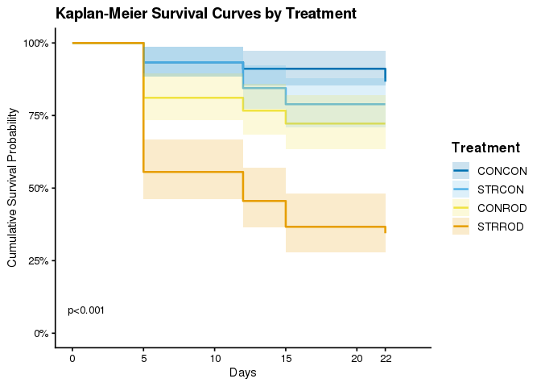<!-- -->

``` r
df.F.mortality <- df.mortality %>%
  group_by(Treatment) %>%
  summarise(
    Total     = n(),
    Deaths    = sum(Status == 1),
    Mortality = Deaths / Total * 100,
    SE        = sqrt((Mortality/100 * (1 - Mortality/100)) / Total) * 100
  ) %>%
  ungroup()


df.F.mortality$Treatment <- factor(
  df.F.mortality$Treatment,
  levels = c("CONCON", "STRCON", "CONROD", "STRROD")
)

finalmort.plot <- ggplot(df.F.mortality, aes(x = Treatment, y = Mortality, fill = Treatment)) +
  geom_col(width = 0.6, colour = "black", linewidth = 0.4, alpha=0.9) +
  geom_errorbar(aes(ymin = Mortality - SE, ymax = Mortality + SE),width    = 0.2,linewidth = 0.7) +
  scale_fill_manual(values = col_pal) +
  scale_y_continuous(
    limits = c(0, 80),
    breaks = seq(0, 80, 10),
    labels = function(x) paste0(x, "%"),
    expand = expansion(mult = c(0, 0.05))
  ) +
  labs(
    title    = "Final Mortality by Treatment Group",
    x        = "Treatment",
    y        = "Mortality (%)"
  ) +
  theme_classic(base_size = 13) +
  theme(
    plot.title      = element_text(face = "bold", size = 14),
    plot.subtitle   = element_text(size = 11, colour = "grey40"),
    axis.title      = element_text(size = 12),
    axis.text       = element_text(size = 11),
    legend.position = "none"
  )


finalmort.plot
```

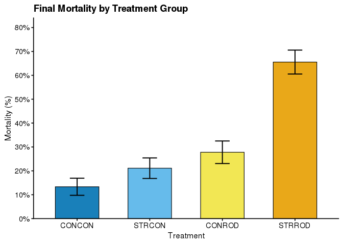<!-- -->

# Bioinformatics

## SNP calling

``` bash
mamba env create -f ROD_CADO.yml
mamba activate ROD_CADO

cd ./analysis

../scripts/dDocent_ngs dDocent.config
```

## SNP filtering

``` bash
source activate ROD_CADO

cd ./analysis/raw.vcf
../../scripts/PVCF_filter.sh TRS 36
cd filtered
vcftools --gzvcf SNP.TRS.TRSdp5g75.nDNA.g1.maf01.FIL.vcf.gz --minDP 10 --recode --recode-INFO-all --stdout | vcftools --vcf - --max-missing 1.0 --maf 0.01 --recode --recode-INFO-all --stdout | bcftools view --threads 24 -O z -o SNP.TRSdp10g1.FIL.vcf.gz
bcftools --threads 40 -m2 -M2 -O z -o SNP.TRSdp10g1max2alleles.FIL.vcf.gz SNP.TRSdp10g1.FIL.vcf.gz
plink2 --allow-extra-chr --make-bed --out TRSdp10g1.FIL --vcf SNP.TRSdp10g1max2alleles.FIL.vcf.gz
```

# Diversity Metrics

## Nucleotide diversity

Original analysis by Jacob Green, edits by JBP

### Calculate from vcf files

``` bash
source activate ROD_CADO
mkdir -p ./analysis/diversity_statistics/nd
cd ./analysis/diversity_statistics/nd

cp ../../../treat_popmap .

awk '$2 == "CON-CON" {print $1}' treat_popmap > con-con.txt 
awk '$2 == "STR-CON" {print $1}' treat_popmap > str-con.txt 
awk '$2 == "CON-ROD" {print $1}' treat_popmap > con-rod.txt 
awk '$2 == "STR-ROD" {print $1}' treat_popmap > str-rod.txt
```

``` bash
source activate ROD_CADO
cd ./analysis/diversity_statistics/nd


bcftools view --threads 20 ../../raw.vcf/filtered/SNP.TRSdp10g1.FIL.vcf.gz -S con-con.txt | vcftools --vcf - --window-pi 10000 --out con-con

bcftools view --threads 20 ../../raw.vcf/filtered/SNP.TRSdp10g1.FIL.vcf.gz -S str-con.txt | vcftools --vcf - --window-pi 10000 --out str-con

bcftools view --threads 20 ../../raw.vcf/filtered/SNP.TRSdp10g1.FIL.vcf.gz -S con-rod.txt | vcftools --vcf - --window-pi 10000 --out con-rod

bcftools view --threads 20 ../../raw.vcf/filtered/SNP.TRSdp10g1.FIL.vcf.gz -S str-rod.txt | vcftools --vcf - --window-pi 10000 --out str-rod
```

### Load into R

``` r
pi.concon.dataframe<-read.table("analysis/diversity_statistics/nd/con-con.windowed.pi", sep="\t", header=T)
pi.conrod.dataframe<-read.table("analysis/diversity_statistics/nd/con-rod.windowed.pi", sep="\t", header=T)
pi.strcon.dataframe<-read.table("analysis/diversity_statistics/nd/str-con.windowed.pi", sep="\t", header=T)
pi.strrod.dataframe<-read.table("analysis/diversity_statistics/nd/str-rod.windowed.pi", sep="\t", header=T)

pi.concon.dataframe$Treatment <- "CONCON"
pi.conrod.dataframe$Treatment <- "CONROD"
pi.strcon.dataframe$Treatment <- "STRCON"
pi.strrod.dataframe$Treatment <- "STRROD"

pi.df <- rbind(pi.concon.dataframe,pi.conrod.dataframe,pi.strcon.dataframe, pi.strrod.dataframe)
pi.df$Treatment <- factor(pi.df$Treatment, levels=c("CONCON", "STRCON", "CONROD", "STRROD"))
```

``` r
pi.plot <- ggplot(pi.df, aes(x=PI,y = Treatment))+
  geom_violin(aes(color=Treatment,fill= Treatment), alpha=0.9) +
  geom_boxplot(width=0.25,outlier.shape = NA, outlier.color = NA, fill = NA)+
  stat_summary(fun=mean, geom="point", shape=23, size=2)+
  scale_fill_manual(values=col_pal)+
  scale_color_manual(values=col_pal)+
  scale_y_discrete(limits = rev(levels(pi.df$Treatment)))+
  labs(x=expression(pi)) +
  ggtitle("Nucleotide Diversity by Treatment")+
  theme_classic(base_size = 13) +
  theme(axis.title.y = element_blank(),plot.title = element_text(face = "bold"),legend.title   = element_text(face = "bold")) 

pi.plot
```

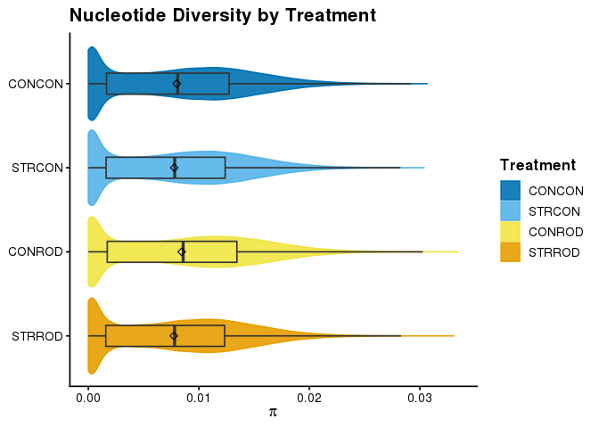<!-- -->

``` r
group_by(pi.df, Treatment) %>%
  dplyr::summarise(
    count = n(),
    mean = mean(PI, na.rm = TRUE),
    sd = sd(PI, na.rm = TRUE),
    se=std.error(PI, na.rm = TRUE) )
```

    ## # A tibble: 4 × 5
    ##   Treatment count    mean      sd        se
    ##   <fct>     <int>   <dbl>   <dbl>     <dbl>
    ## 1 CONCON    40827 0.00800 0.00620 0.0000307
    ## 2 STRCON    40841 0.00777 0.00603 0.0000299
    ## 3 CONROD    40838 0.00844 0.00652 0.0000322
    ## 4 STRROD    40841 0.00773 0.00601 0.0000297

``` r
aov.pi <- aov(PI ~ Treatment, pi.df)
summary(aov.pi)
```

    ##                 Df Sum Sq  Mean Sq F value Pr(>F)    
    ## Treatment        3  0.013 0.004338   113.2 <2e-16 ***
    ## Residuals   163343  6.262 0.000038                   
    ## ---
    ## Signif. codes:  0 '***' 0.001 '**' 0.01 '*' 0.05 '.' 0.1 ' ' 1

``` r
posthoc.pi <- TukeyHSD(aov.pi)
posthoc.pi
```

    ##   Tukey multiple comparisons of means
    ##     95% family-wise confidence level
    ## 
    ## Fit: aov(formula = PI ~ Treatment, data = pi.df)
    ## 
    ## $Treatment
    ##                        diff           lwr           upr     p adj
    ## STRCON-CONCON -2.270033e-04 -0.0003383248 -1.156818e-04 0.0000010
    ## CONROD-CONCON  4.435688e-04  0.0003322452  5.548923e-04 0.0000000
    ## STRROD-CONCON -2.664686e-04 -0.0003777901 -1.551471e-04 0.0000000
    ## CONROD-STRCON  6.705721e-04  0.0005592581  7.818860e-04 0.0000000
    ## STRROD-STRCON -3.946532e-05 -0.0001507773  7.184662e-05 0.7990746
    ## STRROD-CONROD -7.100374e-04 -0.0008213514 -5.987234e-04 0.0000000

## Heterozygosity

Analysis by Coline Caillon with edits by Jon Puritz

``` bash
source activate ROD_CADO
mkdir -p ./analysis/diversity_statistics/het
cd ./analysis/diversity_statistics/het

popStats -y GT --file <(bcftools view --threads 40 ../../raw.vcf/filtered/SNP.TRSdp10g1.FIL.vcf.gz) --target 0,1,2,3,4,5,6,7,8,9,10,11,12,13,14,15,16,17,18,19 > CONCON.het &

popStats -y GT --file <(bcftools view --threads 40 ../../raw.vcf/filtered/SNP.TRSdp10g1.FIL.vcf.gz) --target 20,21,22,23,24,25,26,27,28,29,30,31,32,33,34,35,36,37,38,39 > STRCON.het &

popStats -y GT --file <(bcftools view --threads 40 ../../raw.vcf/filtered/SNP.TRSdp10g1.FIL.vcf.gz) --target 40,41,42,43,44,45,46,47,48,49,50,51,52,53,54,55,56,57,58,59 > CONROD.het &

popStats -y GT --file <(bcftools view --threads 40 ../../raw.vcf/filtered/SNP.TRSdp10g1.FIL.vcf.gz) --target 60,61,62,63,64,65,66,67,68,69,70,71,72,73,74,75,76,77,78,79 > STRROD.het
```

``` bash
source activate ROD_CADO
cd ./analysis/diversity_statistics/het

# CON-CON
cat <(echo -e "CHROM\tBIN_START\tBIN_END\tN_SITES\tN_SNPs\tHET\tTREAT") <(mawk '{if (NR>1) print $1 "\t" $2-1 "\t" $2 "\t" $4 "\t" $5 "\tCONCON"}' CONCON.het) > CONCON-treat.het

# STR-CON
cat <(echo -e "CHROM\tBIN_START\tBIN_END\tN_SITES\tN_SNPs\tHET\tTREAT") <(mawk '{if (NR>1) print $1 "\t" $2-1 "\t" $2 "\t" $4 "\t" $5 "\tSTRCON"}' STRCON.het) > STRCON-treat.het

# CON-ROD
cat <(echo -e "CHROM\tBIN_START\tBIN_END\tN_SITES\tN_SNPs\tHET\tTREAT") <(mawk '{if (NR>1) print $1 "\t" $2-1 "\t" $2 "\t" $4 "\t" $5 "\tCONROD"}' CONROD.het) > CONROD-treat.het

# STR-ROD
cat <(echo -e "CHROM\tBIN_START\tBIN_END\tN_SITES\tN_SNPs\tHET\tTREAT") <(mawk '{if (NR>1) print $1 "\t" $2-1 "\t" $2 "\t" $4 "\t" $5 "\tSTRROD"}' STRROD.het) > STRROD-treat.het
```

``` bash
source activate ROD_CADO
cd ./analysis/diversity_statistics/het
bedtools makewindows -g ../../../other_files/genome.file -w 10000 | mawk '!/NC_007175.2/' > 10kb.bed

bedtools intersect -b CONCON-treat.het -a 10kb.bed -wa -wb | bedtools merge -d -1 -c 7,8 -o mean > CONCON.het.10kb.bed &
bedtools intersect -b CONROD-treat.het -a 10kb.bed -wa -wb | bedtools merge -d -1 -c 7,8 -o mean > CONROD.het.10kb.bed &
bedtools intersect -b STRCON-treat.het -a 10kb.bed -wa -wb | bedtools merge -d -1 -c 7,8 -o mean > STRCON.het.10kb.bed &
bedtools intersect -b STRROD-treat.het -a 10kb.bed -wa -wb | bedtools merge -d -1 -c 7,8 -o mean > STRROD.het.10kb.bed

wait

cat <(echo -e "CHROM\tBIN_START\tBIN_END\tEXP_HET\tOBS_HET\tTREATMENT") <(mawk '{if (NR>1)print $0 "\tCONCON"}' CONCON.het.10kb.bed) <(mawk '{if (NR>1)print $0 "\tCONROD"}' CONROD.het.10kb.bed) <(mawk '{if (NR>1)print $0 "\tSTRCON"}' STRCON.het.10kb.bed) <(mawk '{if (NR>1)print $0 "\tSTRROD"}' STRROD.het.10kb.bed)  > treat.10kb.txt
```

### Load into R

``` r
het.df <- read.table("analysis/diversity_statistics/het/treat.10kb.txt", sep="\t", header=T)
het.df$Treatment <- factor(het.df$TREATMENT, levels=c("CONCON", "STRCON", "CONROD", "STRROD"))
```

``` r
het.plot <- ggplot(het.df, aes(x=OBS_HET,y = Treatment))+
  geom_violin(aes(color=Treatment,fill= Treatment), alpha =0.9) +
  geom_boxplot(width=0.25,outlier.shape = NA, outlier.color = NA, fill = NA)+
  stat_summary(fun=mean, geom="point", shape=23, size=2)+
  scale_fill_manual(values=col_pal)+
  scale_color_manual(values=col_pal)+
  scale_y_discrete(limits = rev(levels(het.df$Treatment)))+
  labs(x="Observed Heterozygosity") +
  ggtitle("Observed Heterozygosity by Treatment")+
  theme_classic(base_size = 13) +
    theme(axis.title.y = element_blank(),plot.title = element_text(face = "bold"),legend.title   = element_text(face = "bold")) 
het.plot
```

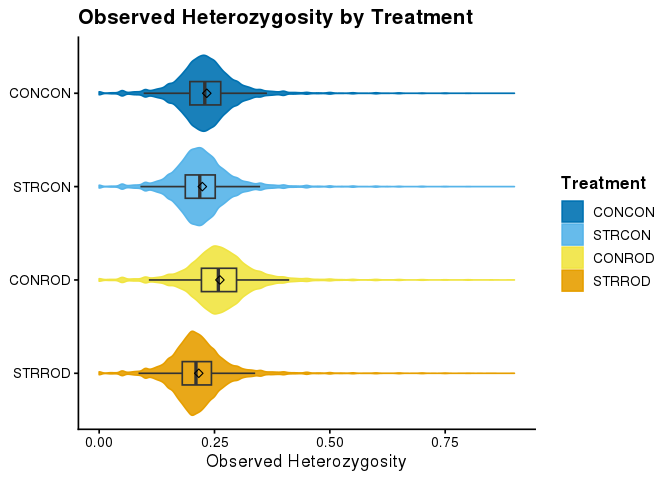<!-- -->

``` r
group_by(het.df, Treatment) %>%
  dplyr::summarise(
    count = n(),
    mean = mean(OBS_HET, na.rm = TRUE),
    sd = sd(OBS_HET, na.rm = TRUE),
    se=std.error(OBS_HET) )
```

    ## # A tibble: 4 × 5
    ##   Treatment count  mean     sd       se
    ##   <fct>     <int> <dbl>  <dbl>    <dbl>
    ## 1 CONCON    40893 0.233 0.0743 0.000368
    ## 2 STRCON    40893 0.224 0.0735 0.000363
    ## 3 CONROD    40893 0.262 0.0814 0.000402
    ## 4 STRROD    40893 0.216 0.0714 0.000353

``` r
aov.het <- aov(OBS_HET ~ Treatment, het.df)
summary(aov.het)
```

    ##                 Df Sum Sq Mean Sq F value Pr(>F)    
    ## Treatment        3   49.2  16.393    2895 <2e-16 ***
    ## Residuals   163568  926.2   0.006                   
    ## ---
    ## Signif. codes:  0 '***' 0.001 '**' 0.01 '*' 0.05 '.' 0.1 ' ' 1

``` r
posthoc.het <- TukeyHSD(aov.het)
posthoc.het
```

    ##   Tukey multiple comparisons of means
    ##     95% family-wise confidence level
    ## 
    ## Fit: aov(formula = OBS_HET ~ Treatment, data = het.df)
    ## 
    ## $Treatment
    ##                       diff          lwr          upr p adj
    ## STRCON-CONCON -0.009629106 -0.010981058 -0.008277154     0
    ## CONROD-CONCON  0.028424751  0.027072799  0.029776703     0
    ## STRROD-CONCON -0.017390565 -0.018742517 -0.016038614     0
    ## CONROD-STRCON  0.038053857  0.036701905  0.039405809     0
    ## STRROD-STRCON -0.007761459 -0.009113411 -0.006409507     0
    ## STRROD-CONROD -0.045815316 -0.047167268 -0.044463364     0

## Tajima’s D

Code by Megan Guidry with edits by Jon Puritz

``` bash
mamba create -n vkrc python=3.8 numpy scipy
source activate vkrc
pip install VCF-kit
mamba install bcftools
```

``` bash
source activate vkrc
mkdir -p ./analysis/diversity_statistics/td
cd ./analysis/diversity_statistics/td

bcftools view --threads 20 ../../raw.vcf/filtered/SNP.TRSdp10g1.FIL.vcf.gz -S ../nd/con-con.txt | vk tajima 10000 10000 - > con-con.tajima &

bcftools view --threads 20 ../../raw.vcf/filtered/SNP.TRSdp10g1.FIL.vcf.gz -S ../nd/str-con.txt | vk tajima 10000 10000 - > str-con.tajima &

bcftools view --threads 20 ../../raw.vcf/filtered/SNP.TRSdp10g1.FIL.vcf.gz -S ../nd/con-rod.txt | vk tajima 10000 10000 - > con-rod.tajima &

bcftools view --threads 20 ../../raw.vcf/filtered/SNP.TRSdp10g1.FIL.vcf.gz -S ../nd/str-rod.txt | vk tajima 10000 10000 - > str-rod.tajima
```

``` bash
source activate ROD_CADO
cd ./analysis/diversity_statistics/td
cat <(echo -e "CHROM\tBIN_START\tBIN_END\tN_SITES\tN_SNPs\tTAJD\tTREATMENT") <(mawk '{if (NR>1)print $0 "\tCONCON"}' con-con.tajima) <(mawk '{if (NR>1)print $0 "\tSTRCON"}' str-con.tajima) <(mawk '{if (NR>1)print $0 "\tCONROD"}' con-rod.tajima) <(mawk '{if (NR>1)print $0 "\tSTRROD"}' str-rod.tajima) > treatment.tajima
```

### Load into R

``` r
tajd.df <- read.table("analysis/diversity_statistics/td/treatment.tajima", sep="\t", header=T)
tajd.df$Treatment <- factor(tajd.df$TREATMENT, levels=c("CONCON", "STRCON", "CONROD", "STRROD"))
```

``` r
tajd.plot <- ggplot(tajd.df, aes(x=TAJD,y = Treatment))+
  geom_violin(aes(color=Treatment,fill= Treatment)) +
  geom_boxplot(width=0.25,outlier.shape = NA, outlier.color = NA, fill = NA)+
  stat_summary(fun=mean, geom="point", shape=23, size=2)+
  scale_fill_manual(values=col_pal)+
  scale_color_manual(values=col_pal)+
  scale_y_discrete(limits = rev(levels(tajd.df$Treatment)))+
  labs(x = expression("Tajima's "*italic(D))) +
  ggtitle(expression("Tajima's "*italic(D)*" by Treatment")) +
  theme_classic(base_size = 13) +
  theme(axis.title.y = element_blank(), text = element_text(family = "Liberation Sans"))

tajd.plot
```

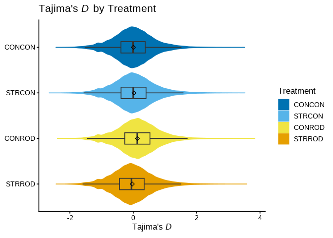<!-- -->

``` r
group_by(tajd.df, Treatment) %>%
  dplyr::summarise(
    count = n(),
    mean = mean(TAJD, na.rm = TRUE),
    sd = sd(TAJD, na.rm = TRUE),
    se=std.error(TAJD) )
```

    ## # A tibble: 4 × 5
    ##   Treatment count     mean    sd      se
    ##   <fct>     <int>    <dbl> <dbl>   <dbl>
    ## 1 CONCON    40718  0.00327 0.641 0.00318
    ## 2 STRCON    40735  0.0209  0.659 0.00326
    ## 3 CONROD    40726  0.131   0.656 0.00325
    ## 4 STRROD    40738 -0.0307  0.646 0.00320

``` r
aov.tajd <- aov(TAJD ~ Treatment, tajd.df)
summary(aov.tajd)
```

    ##                 Df Sum Sq Mean Sq F value Pr(>F)    
    ## Treatment        3    598  199.26   470.9 <2e-16 ***
    ## Residuals   162913  68939    0.42                   
    ## ---
    ## Signif. codes:  0 '***' 0.001 '**' 0.01 '*' 0.05 '.' 0.1 ' ' 1

``` r
posthoc.tajd <- TukeyHSD(aov.tajd)
posthoc.tajd
```

    ##   Tukey multiple comparisons of means
    ##     95% family-wise confidence level
    ## 
    ## Fit: aov(formula = TAJD ~ Treatment, data = tajd.df)
    ## 
    ## $Treatment
    ##                      diff          lwr         upr     p adj
    ## STRCON-CONCON  0.01764763  0.005936456  0.02935880 0.0006261
    ## CONROD-CONCON  0.12770678  0.115994963  0.13941860 0.0000000
    ## STRROD-CONCON -0.03400444 -0.045715393 -0.02229348 0.0000000
    ## CONROD-STRCON  0.11005915  0.098348558  0.12176975 0.0000000
    ## STRROD-STRCON -0.05165206 -0.063361797 -0.03994233 0.0000000
    ## STRROD-CONROD -0.16171122 -0.173421598 -0.15000084 0.0000000

# PCA

Original Code by Jacob Green, edits by Jon Puritz

``` bash
cd analysis/raw.vcf/filtered/
plink2 --bfile TRSdp10g1.FIL --make-bed --allow-extra-chr --out TRSdp10g1.FIL.ALL --maf 0.05
```

``` r
#Set path to file
path_to_file <- "analysis/raw.vcf/filtered/TRSdp10g1.FIL.bed"
#Load file to filename variable
filename <- read.pcadapt(path_to_file, type = "bed")

resld <- pcadapt(filename, K = 10, LD.clumping = list(size = 500, thr = 0.2))
plot(resld, option = "screeplot")
```

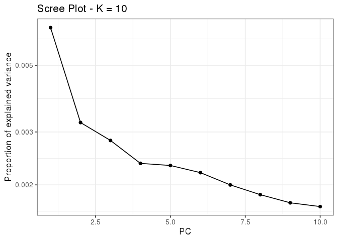<!-- -->

``` r
poplist.names <- c(rep("CONCON",20),rep("STRCON",20),rep("CONROD",20),rep("STRROD",20))
poplist.names
```

    ##  [1] "CONCON" "CONCON" "CONCON" "CONCON" "CONCON" "CONCON" "CONCON" "CONCON"
    ##  [9] "CONCON" "CONCON" "CONCON" "CONCON" "CONCON" "CONCON" "CONCON" "CONCON"
    ## [17] "CONCON" "CONCON" "CONCON" "CONCON" "STRCON" "STRCON" "STRCON" "STRCON"
    ## [25] "STRCON" "STRCON" "STRCON" "STRCON" "STRCON" "STRCON" "STRCON" "STRCON"
    ## [33] "STRCON" "STRCON" "STRCON" "STRCON" "STRCON" "STRCON" "STRCON" "STRCON"
    ## [41] "CONROD" "CONROD" "CONROD" "CONROD" "CONROD" "CONROD" "CONROD" "CONROD"
    ## [49] "CONROD" "CONROD" "CONROD" "CONROD" "CONROD" "CONROD" "CONROD" "CONROD"
    ## [57] "CONROD" "CONROD" "CONROD" "CONROD" "STRROD" "STRROD" "STRROD" "STRROD"
    ## [65] "STRROD" "STRROD" "STRROD" "STRROD" "STRROD" "STRROD" "STRROD" "STRROD"
    ## [73] "STRROD" "STRROD" "STRROD" "STRROD" "STRROD" "STRROD" "STRROD" "STRROD"

``` r
df.pca <- as.data.frame(resld$scores)
colnames(df.pca) <- paste0("PC", 1:ncol(df.pca))

df.pca$Treatment <- poplist.names
df.pca$Treatment <- factor(df.pca$Treatment, levels=c("CONCON", "STRCON", "CONROD", "STRROD"))

variance_explained <- resld$singular.values^2 / sum(resld$singular.values^2) * 100
cat("Variance explained by each PC:\n")
```

    ## Variance explained by each PC:

``` r
print(round(variance_explained, 2))
```

    ##  [1] 24.82 12.00 10.46  8.78  8.63  8.17  7.44  6.90  6.49  6.30

``` r
pca.plot <- ggplot(df.pca, aes(x = PC1, y = PC2, colour = Treatment)) +
  geom_point(size = 2.5, alpha = 0.85) +
  labs(
    title = "PCA of Genetic Variation",
    x = paste0("PC1 (", round(variance_explained[1], 1), "%)"),
    y = paste0("PC2 (", round(variance_explained[2], 1), "%)")
  ) +
  theme_classic(base_size = 13) +
  scale_fill_manual(values=col_pal)+
  scale_color_manual(values=col_pal)+
  theme(
    plot.title     = element_text(face = "bold"),
    legend.title   = element_text(face = "bold"),
    legend.position = "right"
  )

pca.plot
```

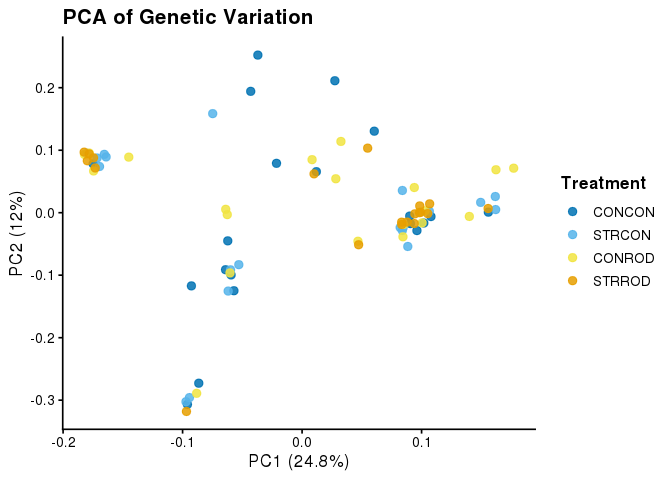<!-- -->

# Figure 1

``` bash
mkdir -p figures
```

``` r
png(filename="figures/Figure1.png", type="cairo",units="px", width=5600, height=3000, res=300, bg="transparent")

gen_div.plot <- (pi.plot / het.plot)

(finalmort.plot + pca.plot)/(km.plot + gen_div.plot) + plot_layout(guides="collect") + plot_annotation(tag_levels = 'A')
dev.off()
```

    ## png 
    ##   2

# Outlier Detection

Original analysis by Amy Zyck, edits by JBP

## Setup

### Prepare genotype file for LFMM2

``` bash
source activate ROD_CADO
mkdir -p ./analysis/outlier_detection
cd ./analysis/outlier_detection
pwd

plink2 --vcf ../raw.vcf/filtered/SNP.TRSdp10g1.FIL.vcf.gz --allow-extra-chr --min-alleles 2 --max-alleles 2 --export A --out snp_rod
cut -f7- snp_rod.raw | tail -n +2 | sed 's/NA/9/g' > snp_rod.lfmm
rm snp_rod.raw
```

### Prepare environmental strata

``` bash
cd ./analysis/outlier_detection
cp -f ../../other_files/strata_ROD_tab .
```

### Create SNP index file

``` bash
source activate ROD_CADO
cd ./analysis/outlier_detection

bcftools view -m 2 -M 2 ../raw.vcf/filtered/SNP.TRSdp10g1.FIL.vcf.gz | bcftools query -f '%CHROM\t%POS\n'  > totalloci
NUM=(`cat totalloci | wc -l`)
paste <(seq 1 $NUM) totalloci > loci.plus.index
```

## Run LFMM2

### Load genotype and environmental data

``` r
clim.env_rod <- read.table("analysis/outlier_detection/strata_ROD_tab", header=TRUE)
strata_ROD <- clim.env_rod
gen_rod <- fread("analysis/outlier_detection/snp_rod.lfmm", header = FALSE)
row.names(gen_rod) <- clim.env_rod$Individual

CADO <- clim.env_rod$CADO
DIS <- clim.env_rod$Disease
COMB_BIN <- clim.env_rod$Combined_Bin
```

### LFMM ridge - Stress (CADO)

``` r
oys_rod_CADO.lfmm <- lfmm_ridge(Y=gen_rod, X=CADO, K=4)
oys_rod_CADO.pv <- lfmm_test(Y=gen_rod, X=CADO, lfmm=oys_rod_CADO.lfmm, calibrate="gif")
oys_rod_CADO.pv$gif
```

``` r
save(oys_rod_CADO.lfmm, oys_rod_CADO.pv, file = "./analysis/outlier_detection/lfmm1_data.RData")
```

``` r
load("./analysis/outlier_detection/lfmm1_data.RData")
```

``` r
zscore_rod_CADO <- oys_rod_CADO.pv$score[,1]
adj.pv_rod_CADO <- pchisq(zscore_rod_CADO^2/0.98, df=1, lower = FALSE)
oys_rod_CADO.qv <- qvalue(adj.pv_rod_CADO)$qvalues
oys_rod_CADO.FDR.1 <- as.vector(which(oys_rod_CADO.qv < 0.1))
length(oys_rod_CADO.FDR.1)
```

    ## [1] 5

``` r
cat("", file = "analysis/outlier_detection/outliers_lfmm2_CADO_098.txt")
invisible(lapply(oys_rod_CADO.FDR.1, write, "analysis/outlier_detection/outliers_lfmm2_CADO_098.txt", append=TRUE))
```

### LFMM ridge - Disease

``` r
oys_rod_DIS.lfmm <- lfmm_ridge(Y=gen_rod, X=DIS, K=4)
oys_rod_DIS.pv <- lfmm_test(Y=gen_rod, X=DIS, lfmm=oys_rod_DIS.lfmm, calibrate="gif")
oys_rod_DIS.pv$gif
```

``` r
save(oys_rod_DIS.lfmm, oys_rod_DIS.pv, file = "./analysis/outlier_detection/lfmm2_data.RData")
```

``` r
load("./analysis/outlier_detection/lfmm2_data.RData")
```

``` r
zscore_rod_DIS <- oys_rod_DIS.pv$score[,1]
adj.pv_rod_DIS <- pchisq(zscore_rod_DIS^2/0.98, df=1, lower = FALSE)
oys_rod_DIS.qv <- qvalue(adj.pv_rod_DIS)$qvalues
oys_rod_DIS.FDR.1 <- as.vector(which(oys_rod_DIS.qv < 0.1))
length(oys_rod_DIS.FDR.1)
```

    ## [1] 3

``` r
cat("", file = "analysis/outlier_detection/outliers_lfmm2_DIS_098.txt")
invisible(lapply(oys_rod_DIS.FDR.1, write, "analysis/outlier_detection/outliers_lfmm2_DIS_098.txt", append=TRUE))
```

### LFMM ridge - Combined treatment (binary)

``` r
oys_rod_CB.lfmm <- lfmm_ridge(Y=gen_rod, X=COMB_BIN, K=4)
oys_rod_CB.pv <- lfmm_test(Y=gen_rod, X=COMB_BIN, lfmm=oys_rod_CB.lfmm, calibrate="gif")
oys_rod_CB.pv$gif
```

``` r
save(oys_rod_CB.lfmm, oys_rod_CB.pv, file = "./analysis/outlier_detection/lfmm3_data.RData")
```

``` r
load("./analysis/outlier_detection/lfmm3_data.RData")
```

``` r
oys_rod_CB.qv <- qvalue(oys_rod_CB.pv$calibrated.pvalue)$qvalues
oys_rod_CB.FDR.1 <- which(oys_rod_CB.qv < 0.1)
length(oys_rod_CB.FDR.1)
```

    ## [1] 107

``` r
cat("", file = "analysis/outlier_detection/outliers_lfmm2_CB.txt")
invisible(lapply(oys_rod_CB.FDR.1, write, "analysis/outlier_detection/outliers_lfmm2_CB.txt", append=TRUE))
```

## Combine outliers and create BED file

### Map SNP indices to genomic positions

``` bash
source activate ROD_CADO
mkdir -p analysis/outlier_detection/results
cd ./analysis/outlier_detection

cat outliers_lfmm2_CADO_098.txt | parallel "grep -w ^{} loci.plus.index" | cut -f2,3 > ./results/outliers_lfmm2_CADO_098.loci.txt
cat outliers_lfmm2_DIS_098.txt | parallel "grep -w ^{} loci.plus.index" | cut -f2,3 > ./results/outliers_lfmm2_DIS_098.loci.txt
cat outliers_lfmm2_CB.txt | parallel "grep -w ^{} loci.plus.index" | cut -f2,3 > ./results/outliers_lfmm2_CB.loci.txt

cat ./results/outliers_lfmm2_CB.loci.txt ./results/outliers_lfmm2_CADO_098.loci.txt ./results/outliers_lfmm2_DIS_098.loci.txt > ./results/all_lfmm2_outliers
awk '{print $1 "\t" $2-1 "\t" $2}' ./results/all_lfmm2_outliers | bedtools sort -i - > ./results/outliers_lfmm2.bed
```

### Create outlier VCF for validation

``` bash
source activate ROD_CADO
cd ./analysis/outlier_detection

bcftools index --threads 20 ../raw.vcf/filtered/SNP.TRSdp10g1.FIL.vcf.gz

bcftools view --threads 20 -R ./results/outliers_lfmm2_CB.loci.txt ../raw.vcf/filtered/SNP.TRSdp10g1.FIL.vcf.gz -O b -o outliers_lfmm2_CB.recode.vcf
```

# FST and OutFLANK

``` bash
source activate ROD_CADO
mkdir -p ./analysis/FST
cd ./analysis/FST

plink2 --bfile ../raw.vcf/filtered/TRSdp10g1.FIL --make-bed --allow-extra-chr --out TRSdp10g1.FIL.ALL --maf 0.05
```

``` r
# Read in bedfile
rds <- snp_readBed("./analysis/raw.vcf/filtered/TRSdp10g1.FIL.ALL.bed", backingfile = tempfile())
```

``` r
full_bed <- snp_attach(rds)
G <- full_bed$genotypes
CHR <- full_bed$map$chromosome
POS <- full_bed$map$physical.pos
NCORES <- nb_cores()
```

``` r
# Cached: autoSVD is slow. Named obj.svd so a missing object errors instead of
# silently resolving to base::svd() (its "subset" attr was NULL -> 0 loci in OutFLANK).
svd_file <- "./analysis/FST/autoSVD.rds"
if (file.exists(svd_file)) {
  obj.svd <- readRDS(svd_file)
} else {
  obj.svd <- snp_autoSVD(G, as.integer(factor(CHR)), POS, ncores = NCORES, min.mac = 8, size = 10)
  saveRDS(obj.svd, svd_file)
}
```

    ## Discarding 0 variant with MAC < 8 or MAF < 0.02.
    ## 
    ## Phase of clumping (on MAF) at r^2 > 0.2.. keep 823655 variants.
    ## 
    ## Iteration 1:
    ## Computing SVD..
    ## 0 outlier variant detected..
    ## 
    ## Converged!

``` r
stopifnot(length(attr(obj.svd, "subset")) > 0)
```

``` r
write(paste(CHR[attr(obj.svd, "subset")],
            POS[attr(obj.svd, "subset")], sep='\t'),
      "./analysis/FST/ThinnedSNPs.maskedPCs.txt")
```

``` bash
source activate ROD_CADO
cd ./analysis/FST
rm -f random.50k.snps

cut -f1 ThinnedSNPs.maskedPCs.txt| uniq | parallel "grep {} ThinnedSNPs.maskedPCs.txt | shuf  2>/dev/null | shuf 2>/dev/null | shuf 2>/dev/null| head -5000" >> random.50k.snps
```

``` bash
source activate ROD_CADO
cd ./analysis/FST

plink2 --bfile ../raw.vcf/filtered/TRSdp10g1.FIL --make-bed --allow-extra-chr --extract bed0 <(mawk '{print $1"\t"$2-1"\t"$2}' random.50k.snps ) --out random50k

mawk 'NR==1{print "IND\tPOP"};NR >0 {print $0}' ../popmap > popmap.txt
```

``` r
rds.random <- snp_readBed("./analysis/FST/random50k.bed", backingfile = tempfile())
popmap <- read.table("./analysis/FST/popmap.txt", header=TRUE)
popmap$TREAT <- c(rep("CONCON",20),rep("STRCON",20),rep("CONROD",20),rep("STRROD",20))

random <- snp_attach(rds.random)
G.r <- random$genotypes
CHR.r <- random$map$chromosome
POS.r <- random$map$physical.pos
```

``` r
my_fst <- MakeDiploidFSTMat(G[], locusNames = paste0(CHR,"_", POS), popNames = popmap$TREAT)

my_fst.r <- MakeDiploidFSTMat(G.r[], locusNames = paste0(CHR.r,"_", POS.r), popNames = popmap$TREAT)
```

``` r
save(my_fst, file = "./analysis/FST/FST_data.RData")
```

``` r
load("./analysis/FST/FST_data.RData")
```

``` r
out_trim <- OutFLANK(my_fst[attr(obj.svd, which="subset"),], NumberOfSamples=4, qthreshold = 0.1, Hmin = 0.1)

OutFLANKResultsPlotter(out_trim, withOutliers = TRUE,
                       NoCorr = TRUE, Hmin = 0.1, binwidth = 0.001, Zoom =
                         FALSE, RightZoomFraction = 0.05, titletext = NULL)
```

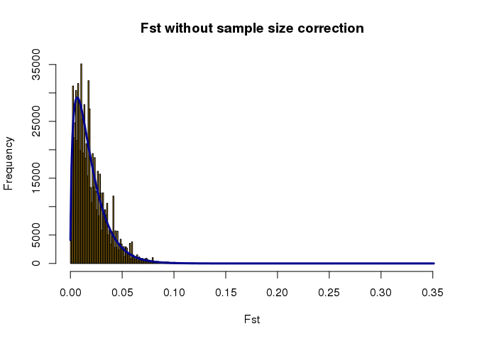<!-- -->

``` r
hist(out_trim$results$pvaluesRightTail)
```

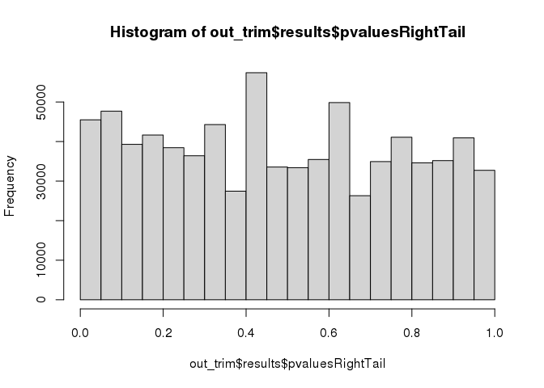<!-- -->

``` r
qthres <- 0.1

P1 <- pOutlierFinderChiSqNoCorr(my_fst, Fstbar = out_trim$FSTNoCorrbar, 
                                   dfInferred = out_trim$dfInferred, qthreshold = qthres, Hmin=0.1)

P1 <- P1[order(as.numeric(rownames(P1))),,drop=FALSE]                  
hist(P1$pvaluesRightTail)
```

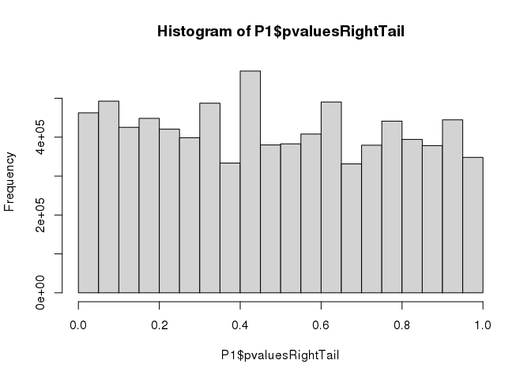<!-- -->

``` r
plot.df<- setNames(data.frame(matrix(ncol = 8, nrow = length(P1$LocusName))), c("CHR", "CHRR", "BP", "SNP", "P", "F", "Q", "Outlier"))
plot.df$CHR <-as.integer(as.factor(CHR))
plot.df$CHRR <- CHR
plot.df$SNP <-P1$LocusName
plot.df$BP <- POS
plot.df$P <- P1$pvalues
plot.df$Q <- P1$qvalues
plot.df$F <- P1$FST
plot.df$Outlier <- P1$OutlierFlag
plot.df <- plot.df[which(plot.df$Outlier == TRUE | plot.df$Outlier == FALSE),]
```

``` r
withr::with_options(c(scipen = 10), write(paste(plot.df$CHRR,plot.df$BP-1,plot.df$BP,plot.df$F,plot.df$Outlier, sep='\t'), "./analysis/FST/FST_Outflank.bed"))
```

``` bash
source activate ROD_CADO
cd ./analysis/FST
bedtools intersect -b <(sort -k 1,1 -k2,2n FST_Outflank.bed) -a <(sort -k 1,1 -k2,2n ../diversity_statistics/het/10kb.bed) -wa -wb -sorted  |bedtools merge -d -1 -c 7,8 -o mean,distinct | mawk 'BEGIN {print "CHROM\tBIN_START\tBIN_END\tWEIGHTED_FST\tOUTLIER"} { if ($0 ~ /TRUE/) {print $1 "\t" $2 "\t" $3 "\t" $4 "\tTRUE"} else {print $0}}' > OF_fst.10kb.bed

cat <(echo -e "CHROM\tBIN_START\tBIN_END\tWEIGHTED_FST\tOUTLIER") OF_fst.10kb.bed <(grep TRUE FST_Outflank.bed) > OF_fst.10kb.txt


cat <(echo -e "CHROM\tBIN_START\tBIN_END\tWEIGHTED_FST\tOUTLIER") FST_Outflank.bed > outlier_fst.txt
```

``` r
fst <- fread("./analysis/FST/outlier_fst.txt", header = TRUE)
SNP<-c(1:(nrow(fst)))
mydf<-data.frame(SNP,fst)
mydf$CHR <- mydf$CHROM
mydf %>% 
  mutate(CHR = str_replace(CHR, "NC_035780.1", "1")) %>% 
  mutate(CHR = str_replace(CHR, "NC_035781.1", "2")) %>% 
  mutate(CHR = str_replace(CHR, "NC_035782.1", "3")) %>% 
  mutate(CHR = str_replace(CHR, "NC_035783.1", "4")) %>% 
  mutate(CHR = str_replace(CHR, "NC_035784.1", "5")) %>% 
  mutate(CHR = str_replace(CHR, "NC_035785.1", "6")) %>% 
  mutate(CHR = str_replace(CHR, "NC_035786.1", "7")) %>% 
  mutate(CHR = str_replace(CHR, "NC_035787.1", "8")) %>%
  mutate(CHR = str_replace(CHR, "NC_035788.1", "9")) %>% 
  mutate(CHR = str_replace(CHR, "NC_035789.1", "10"))  -> mydf
mydf$CHR <- as.numeric(mydf$CHR)  

# Step 1: Compute chromosome-level metrics
chr_offsets <- mydf %>%
  group_by(CHR) %>%
  summarize(
    minbp = min(BIN_START, na.rm = TRUE),
    maxbp = max(BIN_END, na.rm = TRUE),
    nrows = n()
  ) %>%
  mutate(
    offset = cumsum(nrows) - nrows,
    bp_range = ifelse(maxbp == minbp, 1, maxbp - minbp)
  )

# Step 2: Join offset info into the original dataframe and compute BPcum
don <- mydf %>%
  left_join(chr_offsets, by = "CHR") %>%
  mutate(
    scaled_bp = (as.numeric(BIN_START) - as.numeric(minbp)) * as.numeric(nrows) / as.numeric(bp_range),
    BPcum = scaled_bp + as.numeric(offset)
  )

# Step 3: Axis label positions
axisdf <- don %>%
  group_by(CHR) %>%
  summarize(center = mean(BPcum, na.rm = TRUE))


m2<- ggplot(don, aes(x=BPcum, y=WEIGHTED_FST)) +
  geom_point( aes(color=as.factor(CHR)), alpha=0.25, size=0.5) +
  geom_point(data=subset(don, OUTLIER==TRUE),aes(color=as.factor(CHR)),shape = 17,alpha=1,size=1.75) +
  scale_color_manual(values = rep(c("#7d5577", "#52374e"), 5 )) +
  scale_x_continuous( label = axisdf$CHR, breaks= axisdf$center ,expand = c(0,0)) +
  scale_y_continuous(expand = c(0,0),limits=c(min(don$WEIGHTED_FST-0.001,na.rm=TRUE),0.5))+      
  theme(axis.title.y = element_markdown())+ 
  guides(colour = "none",alpha="none", fill="none") +
  labs(x = "Chromosome", y = "*F<sub>ST</sub>*") +
  theme_classic() +
  theme(axis.title.y = element_markdown()) 
    

png(filename="figures/Figure.X.FST.man.png", type="cairo",units="px", width=5600, height=3000, res=300, bg="transparent")
m2
null <- dev.off()
```

# Outlier Overlap and Annotation

Original analysis by Amy Zyck, edits by JBP

## Extract OutFLANK outliers to BED format

``` bash
source activate ROD_CADO
cd ./analysis/FST

awk '$5=="TRUE"{print $1"\t"$2"\t"$3}' FST_Outflank.bed > Outflank_outliers.bed
```

## Compare overlapping outlier SNPs between LFMM2 and OutFLANK

``` bash
source activate ROD_CADO
cd ./analysis

# Sort each bed file
sort ./FST/Outflank_outliers.bed > ./FST/outliers_outflank_sorted.txt
sort ./outlier_detection/results/outliers_lfmm2.bed > ./outlier_detection/results/outliers_lfmm2_sorted.txt
```

``` bash
cd ./analysis

# Shared outlier SNPs between OutFLANK and LFMM2
comm -12 ./FST/outliers_outflank_sorted.txt ./outlier_detection/results/outliers_lfmm2_sorted.txt | wc -l
comm -12 ./FST/outliers_outflank_sorted.txt ./outlier_detection/results/outliers_lfmm2_sorted.txt
```

## Validate all LFMM2 outliers with PCA and PERMANOVA

### Create VCF for all LFMM2 outliers

``` bash
source activate ROD_CADO
cd ./analysis/outlier_detection

bcftools view --threads 20 -R ./results/outliers_lfmm2.bed ../raw.vcf/filtered/SNP.TRSdp10g1.FIL.vcf.gz > outliers_lfmm2_all.recode.vcf
```

### Load and analyze all LFMM2 outliers

``` r
vcf_out_lfmm_all <- read.vcfR("analysis/outlier_detection/outliers_lfmm2_all.recode.vcf")
```

    ## Scanning file to determine attributes.
    ## File attributes:
    ##   meta lines: 99
    ##   header_line: 100
    ##   variant count: 115
    ##   column count: 89
    ## Meta line 99 read in.
    ## All meta lines processed.
    ## gt matrix initialized.
    ## Character matrix gt created.
    ##   Character matrix gt rows: 115
    ##   Character matrix gt cols: 89
    ##   skip: 0
    ##   nrows: 115
    ##   row_num: 0
    ## Processed variant: 115
    ## All variants processed

``` r
rad_out_lfmm_all.filt <- vcfR2genind(vcf_out_lfmm_all, strata = strata_ROD, pop = popmap$TREAT)
```

``` r
x_out_lfmm_all <- scaleGen(rad_out_lfmm_all.filt, NA.method = "mean")
out_lfmm_all_pca <- dudi.pca(x_out_lfmm_all, center = FALSE, scale = FALSE, scannf = FALSE, nf = 4)
pc_scores_lfmm_all <- out_lfmm_all_pca$li
```

``` r
permanova_result_lfmm_all <- adonis2(pc_scores_lfmm_all ~ poplist.names, method = "euclidean")
print(permanova_result_lfmm_all)
```

    ## Permutation test for adonis under reduced model
    ## Permutation: free
    ## Number of permutations: 999
    ## 
    ## adonis2(formula = pc_scores_lfmm_all ~ poplist.names, method = "euclidean")
    ##          Df SumOfSqs      R2      F Pr(>F)    
    ## Model     3   6840.2 0.54376 30.193  0.001 ***
    ## Residual 76   5739.2 0.45624                  
    ## Total    79  12579.3 1.00000                  
    ## ---
    ## Signif. codes:  0 '***' 0.001 '**' 0.01 '*' 0.05 '.' 0.1 ' ' 1

``` r
pca_data_lfmm_all <- data.frame(
  PC1 = pc_scores_lfmm_all[,1],
  PC2 = pc_scores_lfmm_all[,2],
  Treatment = factor(poplist.names, levels = c("CONCON", "STRCON", "CONROD", "STRROD"))
)

p_value_lfmm_all <- permanova_result_lfmm_all$`Pr(>F)`[1]
eigenvalues_lfmm_all <- eigen(cov(pca_data_lfmm_all[, c("PC1", "PC2")]))$values
pve_lfmm_all <- eigenvalues_lfmm_all / sum(eigenvalues_lfmm_all) * 100

outlier.pca.lfmm.all.plot <- ggplot(pca_data_lfmm_all, aes(x = PC1, y = PC2, color = Treatment)) +
  geom_point(size = 2.5, alpha = 0.8) +
  stat_ellipse() +
  scale_color_manual(values = col_pal) +
  labs(
    title = "PCA of All LFMM2 Outlier SNPs",
    x = paste0("PC1 (", round(pve_lfmm_all[1], 1), "%)"),
    y = paste0("PC2 (", round(pve_lfmm_all[2], 1), "%)")
  ) +
  annotate("text", x = -Inf, y = -Inf,
           label = paste("PERMANOVA p =", format(p_value_lfmm_all, digits = 2)),
           hjust = -0.1, vjust = -1, size = 3.5) +
  theme_classic(base_size = 13) +
  theme(
    plot.title = element_text(face = "bold"),
    legend.title = element_text(face = "bold"),
    legend.position = "right"
  )

outlier.pca.lfmm.all.plot
```

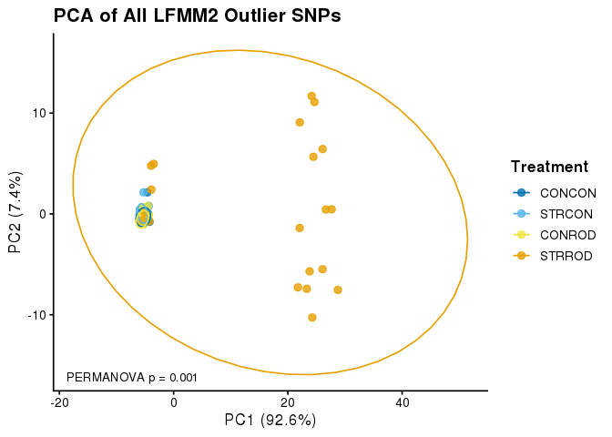<!-- -->

## Validate OutFLANK outliers with PCA and PERMANOVA

### Create VCF for OutFLANK outliers

``` bash
source activate ROD_CADO
cd ./analysis/FST

bcftools view --threads 20 -R Outflank_outliers.bed ../raw.vcf/filtered/SNP.TRSdp10g1.FIL.vcf.gz > outliers_Outflank.recode.vcf
```

### Load and analyze OutFLANK outliers

``` r
vcf_out_outflank <- read.vcfR("analysis/FST/outliers_Outflank.recode.vcf")
```

    ## Scanning file to determine attributes.
    ## File attributes:
    ##   meta lines: 99
    ##   header_line: 100
    ##   variant count: 126
    ##   column count: 89
    ## Meta line 99 read in.
    ## All meta lines processed.
    ## gt matrix initialized.
    ## Character matrix gt created.
    ##   Character matrix gt rows: 126
    ##   Character matrix gt cols: 89
    ##   skip: 0
    ##   nrows: 126
    ##   row_num: 0
    ## Processed variant: 126
    ## All variants processed

``` r
rad_out_outflank.filt <- vcfR2genind(vcf_out_outflank, strata = strata_ROD, pop = popmap$TREAT)
```

``` r
x_out_outflank <- scaleGen(rad_out_outflank.filt, NA.method = "mean")
out_outflank_pca <- dudi.pca(x_out_outflank, center = FALSE, scale = FALSE, scannf = FALSE, nf = 4)
pc_scores_outflank <- out_outflank_pca$li
```

``` r
permanova_result_outflank <- adonis2(pc_scores_outflank ~ popmap$TREAT, method = "euclidean")
print(permanova_result_outflank)
```

    ## Permutation test for adonis under reduced model
    ## Permutation: free
    ## Number of permutations: 999
    ## 
    ## adonis2(formula = pc_scores_outflank ~ popmap$TREAT, method = "euclidean")
    ##          Df SumOfSqs      R2      F Pr(>F)    
    ## Model     3   6979.3 0.52456 27.951  0.001 ***
    ## Residual 76   6325.8 0.47544                  
    ## Total    79  13305.1 1.00000                  
    ## ---
    ## Signif. codes:  0 '***' 0.001 '**' 0.01 '*' 0.05 '.' 0.1 ' ' 1

``` r
pca_data_outflank <- data.frame(
  PC1 = pc_scores_outflank[,1],
  PC2 = pc_scores_outflank[,2],
  Treatment = factor(poplist.names, levels = c("CONCON", "STRCON", "CONROD", "STRROD"))
)

p_value_outflank <- permanova_result_outflank$`Pr(>F)`[1]
eigenvalues_outflank <- eigen(cov(pca_data_outflank[, c("PC1", "PC2")]))$values
pve_outflank <- eigenvalues_outflank / sum(eigenvalues_outflank) * 100

outlier.pca.outflank.plot <- ggplot(pca_data_outflank, aes(x = PC1, y = PC2, color = Treatment)) +
  geom_point(size = 2.5, alpha = 0.8) +
  stat_ellipse() +
  scale_color_manual(values = col_pal) +
  labs(
    title = "PCA of OutFLANK Outlier SNPs",
    x = paste0("PC1 (", round(pve_outflank[1], 1), "%)"),
    y = paste0("PC2 (", round(pve_outflank[2], 1), "%)")
  ) +
  annotate("text", x = -Inf, y = -Inf,
           label = paste("PERMANOVA p =", format(p_value_outflank, digits = 2)),
           hjust = -0.1, vjust = -1, size = 3.5) +
  theme_classic(base_size = 13) +
  theme(
    plot.title = element_text(face = "bold"),
    legend.title = element_text(face = "bold"),
    legend.position = "right"
  )

outlier.pca.outflank.plot
```

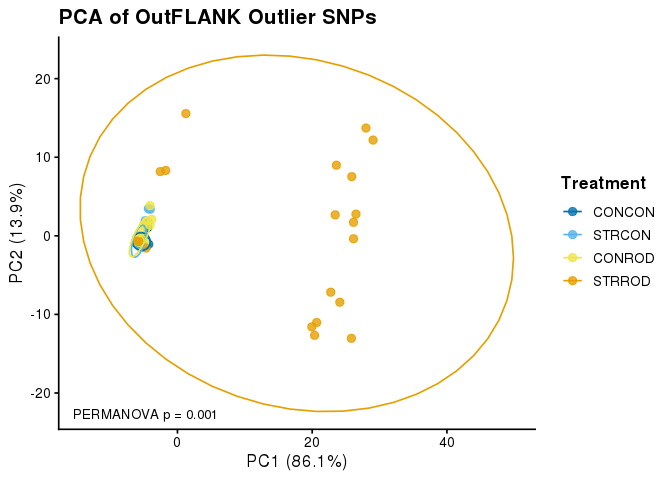<!-- -->

## PCA of combined LFMM2 and OutFLANK outliers

### Create combined outlier BED and VCF

``` bash
source activate ROD_CADO
cd ./analysis

# Merge LFMM2 and OutFLANK outlier BEDs, sort and deduplicate
cat ./outlier_detection/results/outliers_lfmm2.bed ./FST/Outflank_outliers.bed | bedtools sort -i - | bedtools merge -i - > ./outlier_detection/results/outliers_lfmm2_outflank_combined.bed

bcftools view --threads 20 -R ./outlier_detection/results/outliers_lfmm2_outflank_combined.bed ./raw.vcf/filtered/SNP.TRSdp10g1.FIL.vcf.gz -O v -o ./outlier_detection/outliers_combined.recode.vcf
```

### Load and analyze combined outliers

``` r
vcf_out_combined <- read.vcfR("analysis/outlier_detection/outliers_combined.recode.vcf")
```

    ## Scanning file to determine attributes.
    ## File attributes:
    ##   meta lines: 99
    ##   header_line: 100
    ##   variant count: 150
    ##   column count: 89
    ## Meta line 99 read in.
    ## All meta lines processed.
    ## gt matrix initialized.
    ## Character matrix gt created.
    ##   Character matrix gt rows: 150
    ##   Character matrix gt cols: 89
    ##   skip: 0
    ##   nrows: 150
    ##   row_num: 0
    ## Processed variant: 150
    ## All variants processed

``` r
rad_out_combined.filt <- vcfR2genind(vcf_out_combined, strata = strata_ROD, pop = popmap$TREAT)
```

``` r
x_out_combined <- scaleGen(rad_out_combined.filt, NA.method = "mean")
out_combined_pca <- dudi.pca(x_out_combined, center = FALSE, scale = FALSE, scannf = FALSE, nf = 4)
pc_scores_combined <- out_combined_pca$li
```

``` r
permanova_result_combined <- adonis2(pc_scores_combined ~ popmap$TREAT, method = "euclidean")
print(permanova_result_combined)
```

    ## Permutation test for adonis under reduced model
    ## Permutation: free
    ## Number of permutations: 999
    ## 
    ## adonis2(formula = pc_scores_combined ~ popmap$TREAT, method = "euclidean")
    ##          Df SumOfSqs      R2      F Pr(>F)    
    ## Model     3   7946.6 0.52662 28.182  0.001 ***
    ## Residual 76   7143.2 0.47338                  
    ## Total    79  15089.8 1.00000                  
    ## ---
    ## Signif. codes:  0 '***' 0.001 '**' 0.01 '*' 0.05 '.' 0.1 ' ' 1

``` r
pca_data_combined <- data.frame(
  PC1 = pc_scores_combined[,1],
  PC2 = pc_scores_combined[,2],
  Treatment = factor(poplist.names, levels = c("CONCON", "STRCON", "CONROD", "STRROD"))
)

p_value_combined <- permanova_result_combined$`Pr(>F)`[1]
eigenvalues_combined <- eigen(cov(pca_data_combined[, c("PC1", "PC2")]))$values
pve_combined <- eigenvalues_combined / sum(eigenvalues_combined) * 100

outlier.pca.combined.plot <- ggplot(pca_data_combined, aes(x = PC1, y = PC2, color = Treatment)) +
  geom_point(size = 2.5, alpha = 0.8) +
  stat_ellipse() +
  scale_color_manual(values = col_pal) +
  labs(
    title = "PCA of Combined LFMM2 + OutFLANK Outlier SNPs",
    x = paste0("PC1 (", round(pve_combined[1], 1), "%)"),
    y = paste0("PC2 (", round(pve_combined[2], 1), "%)")
  ) +
  annotate("text", x = -Inf, y = -Inf,
           label = paste("PERMANOVA p =", format(p_value_combined, digits = 2)),
           hjust = -0.1, vjust = -1, size = 3.5) +
  theme_classic(base_size = 13) +
  theme(
    plot.title = element_text(face = "bold"),
    legend.title = element_text(face = "bold"),
    legend.position = "right"
  )

outlier.pca.combined.plot
```

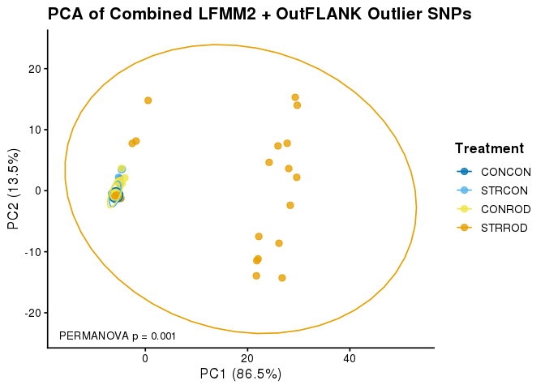<!-- -->

## PCA of overlapping LFMM2 and OutFLANK outlier loci

### Create overlapping outlier BED and VCF

``` bash
source activate ROD_CADO
cd ./analysis

# Extract loci shared between LFMM2 and OutFLANK
bedtools intersect -a ./outlier_detection/results/outliers_lfmm2.bed -b ./FST/Outflank_outliers.bed > ./outlier_detection/results/outliers_overlap_lfmm2_outflank.bed

wc -l ./outlier_detection/results/outliers_overlap_lfmm2_outflank.bed

bcftools view --threads 20 -R ./outlier_detection/results/outliers_overlap_lfmm2_outflank.bed ./raw.vcf/filtered/SNP.TRSdp10g1.FIL.vcf.gz -O v -o ./outlier_detection/outliers_overlap.recode.vcf
```

### Load and analyze overlapping outliers

``` r
vcf_out_overlap <- read.vcfR("analysis/outlier_detection/outliers_overlap.recode.vcf")
```

    ## Scanning file to determine attributes.
    ## File attributes:
    ##   meta lines: 99
    ##   header_line: 100
    ##   variant count: 91
    ##   column count: 89
    ## Meta line 99 read in.
    ## All meta lines processed.
    ## gt matrix initialized.
    ## Character matrix gt created.
    ##   Character matrix gt rows: 91
    ##   Character matrix gt cols: 89
    ##   skip: 0
    ##   nrows: 91
    ##   row_num: 0
    ## Processed variant: 91
    ## All variants processed

``` r
rad_out_overlap.filt <- vcfR2genind(vcf_out_overlap, strata = strata_ROD, pop = popmap$TREAT)
```

``` r
x_out_overlap <- scaleGen(rad_out_overlap.filt, NA.method = "mean")
out_overlap_pca <- dudi.pca(x_out_overlap, center = FALSE, scale = FALSE, scannf = FALSE, nf = 4)
pc_scores_overlap <- out_overlap_pca$li
```

``` r
permanova_result_overlap <- adonis2(pc_scores_overlap ~ popmap$TREAT, method = "euclidean")
print(permanova_result_overlap)
```

    ## Permutation test for adonis under reduced model
    ## Permutation: free
    ## Number of permutations: 999
    ## 
    ## adonis2(formula = pc_scores_overlap ~ popmap$TREAT, method = "euclidean")
    ##          Df SumOfSqs      R2      F Pr(>F)    
    ## Model     3   5927.9 0.54967 30.922  0.001 ***
    ## Residual 76   4856.5 0.45033                  
    ## Total    79  10784.4 1.00000                  
    ## ---
    ## Signif. codes:  0 '***' 0.001 '**' 0.01 '*' 0.05 '.' 0.1 ' ' 1

``` r
pca_data_overlap <- data.frame(
  PC1 = pc_scores_overlap[,1],
  PC2 = pc_scores_overlap[,2],
  Treatment = factor(poplist.names, levels = c("CONCON", "STRCON", "CONROD", "STRROD"))
)

p_value_overlap <- permanova_result_overlap$`Pr(>F)`[1]
eigenvalues_overlap <- eigen(cov(pca_data_overlap[, c("PC1", "PC2")]))$values
pve_overlap <- eigenvalues_overlap / sum(eigenvalues_overlap) * 100

outlier.pca.overlap.plot <- ggplot(pca_data_overlap, aes(x = PC1, y = PC2, color = Treatment)) +
  geom_point(size = 2.5, alpha = 0.8) +
  stat_ellipse() +
  scale_color_manual(values = col_pal) +
  labs(
    title = "PCA of Overlapping LFMM2 & OutFLANK Outlier SNPs",
    x = paste0("PC1 (", round(pve_overlap[1], 1), "%)"),
    y = paste0("PC2 (", round(pve_overlap[2], 1), "%)")
  ) +
  annotate("text", x = -Inf, y = -Inf,
           label = paste("PERMANOVA p =", format(p_value_overlap, digits = 2)),
           hjust = -0.1, vjust = -1, size = 3.5) +
  theme_classic(base_size = 13) +
  theme(
    plot.title = element_text(face = "bold"),
    legend.title = element_text(face = "bold"),
    legend.position = "right"
  )

outlier.pca.overlap.plot
```

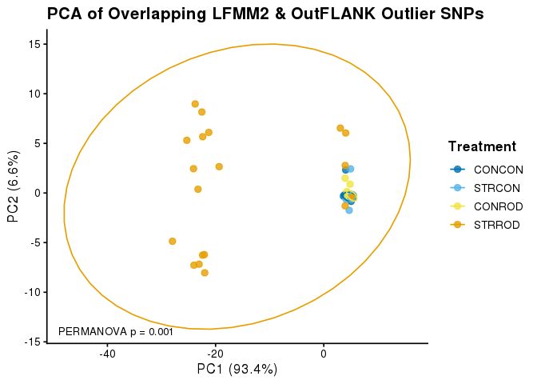<!-- --> \# Figure
2 — Genome-wide LFMM association and focal outlier regions

Panel A is the genome-wide LFMM Manhattan; panel B is a grid of focal
outlier regions showing the per-SNP association signal, π, observed
heterozygosity and Tajima’s *D* by treatment. The outlier PCA is
optional (`show.pca`).

Focal loci can be chosen two ways (`focal.by`):

- `"pvalue"` — the most significant SNPs, thinned by distance. Purely
  association-driven, fully reproducible from this document alone.
- `"file"` — read an explicit list from
  `analysis/figure2/focal_loci.csv` (columns `CHROM`, `POS`, optional
  `name`). Use this to plot a hand-chosen or externally ranked set.

The STRROD-separation ranking that produced one such list lives outside
this document, in `exploratory/separation_score.R`, and is not tracked
in the repository. It is kept separate deliberately: it ranks loci on
the same statistics these panels then display, so separation visible in
the panels is a consequence of the selection, not evidence for it.
Panels chosen that way are exemplars — any genome-wide claim rests on
the outlier test and the treatment-level statistics, not on these
columns.

Because LD decays over hundreds of bp to a few kb in *C. virginica*, the
panels use a ±20 kb window and re-bin the diversity metrics at 500 bp.
The genome-wide 10 kb bins used elsewhere are far too coarse at this
scale.

Depends on objects built above: the LFMM fits (`oys_rod_CB.pv`,
`adj.pv_rod_CADO`, `adj.pv_rod_DIS` and their q-values), and — only when
`show.pca = TRUE` — `pca_data_combined`, `pve_combined`,
`p_value_combined`.

## Settings

`flank` and `binsize` require re-running the bash chunk. Everything else
is R-side only.

``` r
lfmm.var      <- "Combined"   # "Combined" | "CADO" | "Disease" — variable shown in panel A
focal.by      <- "file"       # "file" = analysis/figure2/focal_loci.csv | "pvalue" = top LFMM hits
n.focal       <- 6            # max panels in "pvalue" mode (ignored in "file" mode)
min.sep       <- 50000        # bp; keeps two panels from showing the same locus twice
merge.within  <- 1000         # bp; focal SNPs closer than this share one panel (0 = never)
genic.only    <- FALSE        # TRUE skips SNPs with no overlapping gene (pvalue mode)
flank         <- 12000        # bp either side of the focal SNP
binsize       <- 500          # bp, for the focal-region diversity tracks
smooth.bins   <- 8            # centred rolling mean over this many bins; 1 = raw
show.pca      <- FALSE        # TRUE puts the outlier PCA back in as a panel
ins.top       <- "FST"       # top row of the focal panels: "LFMM" or "FST"
strip.theme   <- NA           # show the GO theme on the panel strip; NA = always (3-row label)

# --- panel A rendering speed -------------------------------------------------
# The dominant cost is that every inline chunk preview redraws the millions of points.
# With preview = FALSE the panels are built but not printed, so the Manhattan is drawn
# once (into the PNG) instead of three times. Set TRUE while iterating on panel design.
preview <- FALSE

# Truncate panel A: draw only SNPs with p <= man.pmax. Unlike random thinning this leaves
# no density artefact — the cloud above the cutoff is drawn in full, the y-axis simply
# starts at -log10(man.pmax). Benchmarked on 8.4M points: p<=0.2 is 6x faster, p<=0.1 is
# 12x, p<=0.05 is 25x. Set man.pmax <- 1 to draw every SNP.
man.pmax <- 0.1

chr.map <- c(NC_035780.1 = 1, NC_035781.1 = 2, NC_035782.1 = 3, NC_035783.1 = 4,
             NC_035784.1 = 5, NC_035785.1 = 6, NC_035786.1 = 7, NC_035787.1 = 8,
             NC_035788.1 = 9, NC_035789.1 = 10)
treat.lv <- c("CONCON", "STRCON", "CONROD", "STRROD")

# Upstream tools spell these differently (VCF-kit writes TajimaD, not TAJD). Resolve the
# wanted column by name first, then by pattern, so downstream chunks do not care.
resolve.col <- function(d, valcol) {
  if (valcol %in% names(d)) return(valcol)
  pat <- c(TAJD = "taj", PI = "^pi$", OBS_HET = "obs.?het", EXP_HET = "exp.?het")[[valcol]]
  hit <- if (length(pat)) grep(pat, names(d), ignore.case = TRUE, value = TRUE) else character(0)
  if (!length(hit))
    stop("column '", valcol, "' not found; have: ", paste(names(d), collapse = ", "))
  hit[1]
}

# ragg renders large point clouds far faster than cairo; fall back if it is not installed
open.png <- function(file, width, height, res) {
  if (requireNamespace("ragg", quietly = TRUE))
    ragg::agg_png(file, width = width, height = height, units = "in",
                  res = res, background = "transparent")
  else
    png(file, type = "cairo", units = "in", width = width, height = height,
        res = res, bg = "transparent")
}
```

## Gene annotation

``` r
genes.bed <- fread("./other_files/sorted.ref3.0.gene.bed", header = FALSE, sep = "\t",
                   select = c(1, 2, 3, 10), col.names = c("CHROM", "GSTART", "GEND", "ATTR"))
genes.bed[, GENE := str_match(ATTR, "gene=([^;]+)")[, 2]]

gene.at <- function(cc, pp) {
  g <- genes.bed[CHROM == cc & GSTART <= pp - 1 & GEND > pp - 1, GENE]
  if (!length(g)) "" else paste(unique(g), collapse = "; ")
}

# Readable labels transcribed from the Discussion draft (AZ & CC). NOT machine-verified
# against NCBI — extend as products are confirmed; anything absent falls back to the LOC id.
gene.labels <- c(
  LOC111121590 = "NF-kB p105",        LOC111125856 = "Rho GAP 7",
  LOC111102361 = "Rho GAP 20",        LOC111129890 = "PP2A reg. sub.",
  LOC111127799 = "PI 5-phosphatase",  LOC111102665 = "DBP / HLF",
  LOC111117505 = "Iroquois irx-2",    LOC111129264 = "prospero hox 1",
  LOC111130344 = "Nrf2",              LOC111120511 = "TFIID subunit 2",
  LOC111130101 = "TBP-like",          LOC111107792 = "BRO1 / VGLL4",
  LOC111107402 = "HDAC6",             LOC111137079 = "PTBP3-like",
  LOC111100729 = "metalloendopept.",  LOC111118036 = "cadherin-23",
  LOC111118850 = "titin / SRRM2",     LOC111119752 = "fibrillin-2",
  LOC111122175 = "polycystin-2",      LOC111125411 = "protocadherin b8",
  LOC111108439 = "semaphorin rec.",   LOC111118776 = "Cul2-RING Ub", 
  LOC111124421 = "UNCH/Mucin-like",   LOC111136420 = "glutathione hydrolase-like",
  LOC111099737 = "MsrB-like",         LOC111108426 = "DOCK3-like")
```

## LFMM p-values

The p-value vector is in the same SNP order as `totalloci` (both derive
from the biallelic subset of `SNP.TRSdp10g1.FIL.vcf.gz`), which is the
mapping the outlier-index chunks above already rely on.

``` r
lfmm.loci <- fread("./analysis/outlier_detection/totalloci",
                   header = FALSE, col.names = c("CHROM", "POS"))

lfmm.pv <- switch(lfmm.var,
  Combined = as.numeric(oys_rod_CB.pv$calibrated.pvalue[, 1]),
  CADO     = as.numeric(adj.pv_rod_CADO),
  Disease  = as.numeric(adj.pv_rod_DIS))
lfmm.qv <- switch(lfmm.var,
  Combined = as.numeric(oys_rod_CB.qv),
  CADO     = as.numeric(oys_rod_CADO.qv),
  Disease  = as.numeric(oys_rod_DIS.qv))

# the join is positional, so a length mismatch means the VCF changed under one of them
stopifnot(nrow(lfmm.loci) == length(lfmm.pv), length(lfmm.pv) == length(lfmm.qv))

lfmm.man <- data.table(CHROM = lfmm.loci$CHROM, POS = lfmm.loci$POS,
                       P = lfmm.pv, Q = lfmm.qv)[CHROM %in% names(chr.map)]

# Some calibrated p-values underflow to exactly 0, which would make -log10(P) infinite and
# blow up the panel A y-scale. Floor them at the smallest non-zero p-value observed, so they
# plot at the top of the real range. P itself is left untouched for ranking and the table.
# If any are floored, say so in the figure legend.
n.zero <- sum(lfmm.man$P <= 0, na.rm = TRUE)
p.floor <- min(lfmm.man$P[lfmm.man$P > 0], na.rm = TRUE)
if (n.zero)
  cat(n.zero, "p-values underflowed to 0; plotted at the smallest non-zero value,",
      format(p.floor, digits = 3), "(-log10 =", round(-log10(p.floor), 1), ")\n")

lfmm.man[, `:=`(CHR = chr.map[CHROM], LOGP = -log10(pmax(P, p.floor)))]
setorder(lfmm.man, CHR, POS)
lfmm.man[, BPcum := seq_len(.N)]
lfmm.axis <- lfmm.man[, .(center = mean(BPcum)), by = CHR]

cat(sum(lfmm.man$Q < 0.1), "SNPs at q < 0.1 for", lfmm.var, "\n")
```

    ## 107 SNPs at q < 0.1 for Combined

## Candidate regions

The candidate pool for `focal.by = "separation"` is the union outlier
set (LFMM ∪ OutFLANK). The bash chunk computes 500 bp tracks across
**all** of these, so scoring and plotting read the same files and no
second pass is needed. 150 loci x 40 kb is ~6 Mb of sequence — seconds.

``` r
outliers.lfmm <- fread("./analysis/outlier_detection/results/outliers_lfmm2.bed",
                       header = FALSE, col.names = c("CHROM", "START", "POS"))
outliers.of   <- fread("./analysis/FST/Outflank_outliers.bed",
                       header = FALSE, col.names = c("CHROM", "START", "POS"))

cands <- unique(rbind(outliers.lfmm, outliers.of)[, .(CHROM, POS)])[
  CHROM %in% names(chr.map)][order(CHROM, POS)]
cands[, CHR := chr.map[CHROM]]
cands <- lfmm.man[, .(CHROM, POS, P, Q, LOGP, BPcum)][cands, on = .(CHROM, POS)]

dir.create("./analysis/figure2", showWarnings = FALSE)
withr::with_options(c(scipen = 10),
  write.table(data.frame(cands$CHROM, pmax(0, cands$POS - flank - 1), cands$POS + flank),
              "./analysis/figure2/candidate_regions.bed",
              sep = "\t", quote = FALSE, row.names = FALSE, col.names = FALSE))
write(binsize, "./analysis/figure2/binsize.txt")

cat(nrow(cands), "candidate outlier loci\n")
```

    ## 150 candidate outlier loci

## Re-bin diversity metrics across the candidate regions

Same tools and options as the genome-wide sections above, restricted to
the candidate regions and binned at `binsize` instead of 10 kb. **Re-run
whenever `flank` or `binsize` changes.**

``` bash
source activate ROD_CADO
cd ./analysis/figure2

VCF=../raw.vcf/filtered/SNP.TRSdp10g1.FIL.vcf.gz
BIN=$(cat binsize.txt)   # set by the `binsize` variable in the R chunk above

sort -k1,1 -k2,2n candidate_regions.bed | bedtools merge -i - > regions.bed

# --- per-SNP FST in the candidate regions (only needed when ins.top = "FST") --
bedtools intersect -a <(sort -k1,1 -k2,2n ../FST/FST_Outflank.bed) \
                   -b regions.bed -wa -sorted \
  | mawk 'BEGIN{print "CHROM\tPOS\tFST\tOUTLIER"} {print $1 "\t" $3 "\t" $4 "\t" $5}' \
  > focal_fst_persnp.txt

# --- nucleotide diversity ------------------------------------------------
for T in con-con str-con con-rod str-rod; do
  bcftools view --threads 20 -R regions.bed $VCF \
      -S ../diversity_statistics/nd/${T}.txt \
    | vcftools --vcf - --window-pi $BIN --out ${T}.focal
done

# --- Tajima's D ----------------------------------------------------------
source activate vkrc
for T in con-con str-con con-rod str-rod; do
  bcftools view --threads 20 -R regions.bed $VCF \
      -S ../diversity_statistics/nd/${T}.txt \
    | vk tajima $BIN $BIN - > ${T}.focal.tajima
done
source activate ROD_CADO

# --- observed heterozygosity --------------------------------------------
# popStats output is already per-site, so this only re-bins the existing *-treat.het files
bedtools makewindows -b regions.bed -w $BIN > focal_bins.bed
for T in CONCON STRCON CONROD STRROD; do
  bedtools intersect -a focal_bins.bed \
                     -b <(sort -k1,1 -k2,2n ../diversity_statistics/het/${T}-treat.het) \
                     -wa -wb \
    | bedtools merge -d -1 -c 7,8 -o mean \
    | mawk -v t=$T '{print $0 "\t" t}' > ${T}.focal.het
done
cat <(echo -e "CHROM\tBIN_START\tBIN_END\tEXP_HET\tOBS_HET\tTREATMENT") \
    CONCON.focal.het STRCON.focal.het CONROD.focal.het STRROD.focal.het > focal.het.txt
```

``` r
treat.files <- c(CONCON = "con-con", STRCON = "str-con",
                 CONROD = "con-rod", STRROD = "str-rod")

pi.focal <- rbindlist(lapply(names(treat.files), function(t) {
  d <- fread(paste0("./analysis/figure2/", treat.files[t], ".focal.windowed.pi"))
  d$Treatment <- t; d }))

# VCF-kit writes its own header (CHROM / BIN_START / BIN_END / N_Sites / N_SNPs / TajimaD),
# so normalise the column names the way the genome-wide chunk does with its echo -e header.
tajd.focal <- rbindlist(lapply(names(treat.files), function(t) {
  d  <- fread(paste0("./analysis/figure2/", treat.files[t], ".focal.tajima"))
  tj <- grep("taj", names(d), ignore.case = TRUE, value = TRUE)
  setnames(d, if (length(tj)) tj[1] else names(d)[6], "TAJD")
  setnames(d, 1:3, c("CHROM", "BIN_START", "BIN_END"))
  d$Treatment <- t; d }))

het.focal <- fread("./analysis/figure2/focal.het.txt", header = TRUE)
setnames(het.focal, "TREATMENT", "Treatment")

for (d in list(pi.focal, tajd.focal, het.focal))
  d[, Treatment := factor(Treatment, levels = treat.lv)]

stopifnot(all(c("CHROM","BIN_START","BIN_END","Treatment") %in% names(pi.focal)),
          all(c("CHROM","BIN_START","BIN_END","Treatment") %in% names(tajd.focal)),
          all(c("CHROM","BIN_START","BIN_END","Treatment") %in% names(het.focal)))
```

## Focal regions

Focal SNPs within `merge.within` bp of each other are drawn in a single
panel: the window is centred on their midpoint and every member SNP gets
its own marker. Adjacent outliers a few bp apart are the common case —
merging them removes a duplicate panel rather than adding information,
so the panel count drops accordingly.

``` r
if (focal.by == "file") {
  f.path <- "./analysis/figure2/focal_loci.csv"
  if (!file.exists(f.path))
    stop(f.path, " not found — either create it or set focal.by <- \"pvalue\"")
  snps <- fread(f.path)
  stopifnot(all(c("CHROM", "POS") %in% names(snps)))
  if (!"name" %in% names(snps)) {
    snps[, gene := mapply(gene.at, CHROM, POS)]
    snps[, name := ifelse(gene %in% names(gene.labels), gene.labels[gene],
                   ifelse(nzchar(gene), gene, "intergenic"))]
  }
  cat("focal SNPs read from", f.path, "\n")
} else {
  cand2 <- lfmm.man[order(P)]
  keep <- integer(0)
  for (i in seq_len(nrow(cand2))) {
    if (length(keep) >= n.focal) break
    if (length(keep) && any(cand2$CHROM[keep] == cand2$CHROM[i] &
                            abs(cand2$POS[keep] - cand2$POS[i]) < min.sep)) next
    if (genic.only && !nzchar(gene.at(cand2$CHROM[i], cand2$POS[i]))) next
    keep <- c(keep, i)
  }
  snps <- cand2[keep, .(CHROM, POS)]
  snps[, gene := mapply(gene.at, CHROM, POS)]
  snps[, name := ifelse(gene %in% names(gene.labels), gene.labels[gene],
                 ifelse(nzchar(gene), gene, "intergenic"))]
}
```

    ## focal SNPs read from ./analysis/figure2/focal_loci.csv

``` r
## --- group SNPs into panels ----------------------------------------------
setorder(snps, CHROM, POS)
snps[, panel := {
  g <- cumsum(c(TRUE, diff(POS) > merge.within))
  paste(CHROM, g)
}, by = CHROM]
if (merge.within <= 0) snps[, panel := paste(CHROM, POS)]

uniq.or.join <- function(x) paste(unique(x), collapse = " / ")
focal <- snps[, .(CHROM  = CHROM[1],
                  POS    = round(mean(POS)),          # panel centre
                  name   = uniq.or.join(name),
                  theme  = if ("theme" %in% names(snps)) uniq.or.join(na.omit(theme)) else NA_character_,
                  n_snps = .N,
                  score  = if ("sep_score" %in% names(snps)) max(sep_score, na.rm = TRUE) else NA_real_),
              by = panel]

# In "file" mode the list is the choice, so every panel is kept. In "pvalue" mode
# n.focal caps the count, strongest first.
if (!all(is.na(focal$score))) setorder(focal, -score, na.last = TRUE)
focal <- as.data.frame(focal)
if (focal.by != "file") focal <- head(focal, n.focal)
# panels and their labels both run in genome order, so i..n reads left to right in
# panel A and in the grid below it
focal <- focal[order(chr.map[focal$CHROM], focal$POS), ]

focal$CHR <- chr.map[focal$CHROM]
focal$region <- tolower(as.character(as.roman(seq_len(nrow(focal)))))

# 3-row strip label: index+chromosome / gene name / GO theme. Wrapping long rows onto
# extra lines (tried first) made the block tall and uneven panel-to-panel \u2014 reads
# worse than it fixes. Instead each row stays a single line: themes get a short strip
# alias below (full text is untouched everywhere else \u2014 legend, table, focal_loci.csv),
# and any gene name over strip.name.max chars is truncated with an ellipsis as a
# backstop. If a future theme/name is still too wide, add it to theme.strip or shorten
# it at the source (focal_loci.csv) rather than reintroducing wrapping.
theme.strip <- c(
  "calcification / ion transport"     = "calcification",
  "cell signalling"                   = "cell signalling",
  "epigenetic / transcriptional"      = "epigenetic",
  "oxidative stress / protein repair" = "oxidative stress",
  "semaphorin / cell-cell"            = "semaphorin")
strip.name.max <- 16

short.theme <- function(x) unname(ifelse(x %in% names(theme.strip), theme.strip[x], x))
short.name  <- function(x) ifelse(nchar(x) > strip.name.max,
                                  paste0(strtrim(x, strip.name.max - 1), "\u2026"), x)

show.theme <- if (is.na(strip.theme)) TRUE else isTRUE(strip.theme)
focal$theme_row <- if (show.theme)
  ifelse(is.na(focal$theme) | !nzchar(focal$theme), "", short.theme(focal$theme)) else ""

focal$lab <- paste0(focal$region, " \u00b7 Chr", focal$CHR, "\n",
                    short.name(focal$name), "\n",
                    focal$theme_row)

# every member SNP, positioned relative to its panel centre — used for the markers
focal.snps <- merge(as.data.table(snps)[, .(panel, CHROM, POS)],
                    as.data.table(focal)[, .(panel, lab, centre = POS)],
                    by = "panel")[, .(region = lab, CHROM, POS, rel = (POS - centre) / 1000)]
focal.snps[, region := factor(region, levels = focal$lab)]

cat(nrow(snps), "focal SNPs ->", nrow(focal), "panels",
    sprintf("(%d merged)", nrow(snps) - nrow(focal)), "\n")
```

    ## 9 focal SNPs -> 7 panels (2 merged)

``` r
focal[, c("region", "CHROM", "POS", "CHR", "name", "n_snps", "theme")]
```

    ##   region       CHROM      POS CHR            name n_snps            theme
    ## 6      i NC_035780.1 65412698   1 UNCH/Mucin-like      1    calcification
    ## 7     ii NC_035781.1 19679572   2   titin / SRRM2      2    calcification
    ## 3    iii NC_035783.1 12033923   4  PP2A reg. sub.      1  cell signalling
    ## 4     iv NC_035784.1 18844271   5       GGT1-like      2 oxidative stress
    ## 5      v NC_035785.1 32344416   6       MsrB-like      1 oxidative stress
    ## 2     vi NC_035787.1 60756955   8 semaphorin rec.      1        cell-cell
    ## 1    vii NC_035787.1 62714735   8      DOCK3-like      1  cell signalling

## Panel A — genome-wide LFMM association

With `man.pmax < 1` the panel is a truncated Manhattan: only SNPs at or
below that p-value are drawn and the y-axis starts at −log10(man.pmax).
**Say so in the figure legend.** The trade-off is that the bulk of the
null distribution is no longer visible, so a reader cannot eyeball
inflation from this panel — worth pairing with a QQ plot in the
supplement, especially since the GIF for the Combined variable was 1.41.

``` r
if (!"BPcum" %in% names(focal))
  focal$BPcum <- vapply(seq_len(nrow(focal)), function(i) {
    sub <- lfmm.man[CHROM == focal$CHROM[i]]
    sub$BPcum[which.min(abs(sub$POS - focal$POS[i]))] }, numeric(1))

# alternate label heights so markers close together on the axis do not overwrite each other
gap <- diff(range(lfmm.man$BPcum)) * 0.03
focal$tier <- 0
if (nrow(focal) > 1)
  for (i in 2:nrow(focal))
    if (focal$BPcum[i] - focal$BPcum[i - 1] < gap)
      focal$tier[i] <- 1 - focal$tier[i - 1]

man.plot <- lfmm.man[P <= man.pmax]
cat(sprintf("panel A: drawing %d of %d SNPs (%.1f%%, p <= %g); y-axis truncated at %.2f\n",
            nrow(man.plot), nrow(lfmm.man), 100 * nrow(man.plot) / nrow(lfmm.man),
            man.pmax, -log10(man.pmax)))
```

    ## panel A: drawing 800438 of 14630885 SNPs (5.5%, p <= 0.1); y-axis truncated at 1.00

``` r
fdr.line  <- if (any(lfmm.man$Q < 0.1)) -log10(max(lfmm.man[Q < 0.1, P])) else NA_real_
lfmm.ymin <- if (man.pmax < 1) -log10(man.pmax) else 0
lfmm.ymax <- max(lfmm.man$LOGP, na.rm = TRUE) * 1.28

fig2.man <- ggplot(man.plot, aes(x = BPcum, y = LOGP)) +
  geom_point(aes(color = as.factor(CHR)), alpha = 0.25, size = 0.4, shape = 16) +
  geom_point(data = lfmm.man[Q < 0.1], aes(color = as.factor(CHR)),
             shape = 17, alpha = 1, size = 1.6) +
  {if (!is.na(fdr.line)) geom_hline(yintercept = fdr.line, linetype = "dashed",
                                    linewidth = 0.3, colour = "grey40")} +
  geom_segment(data = focal, aes(x = BPcum, xend = BPcum,
                                 y = lfmm.ymax * 0.78, yend = lfmm.ymax * (0.88 + tier * 0.055)),
               inherit.aes = FALSE, linewidth = 0.4) +
  geom_text(data = focal, aes(x = BPcum, y = lfmm.ymax * (0.925 + tier * 0.055), label = region),
            inherit.aes = FALSE, size = 3, fontface = "bold") +
  scale_color_manual(values = rep(c("#7d5577", "#52374e"), 5)) +
  scale_x_continuous(label = lfmm.axis$CHR, breaks = lfmm.axis$center,
                     expand = c(0.005, 0)) +
  scale_y_continuous(expand = c(0, 0), limits = c(lfmm.ymin, lfmm.ymax)) +
  guides(colour = "none", alpha = "none", fill = "none") +
  labs(x = "Chromosome", y = "-log<sub>10</sub>(*p*)") +
  theme_classic(base_size = 10) +
  theme(axis.title.y = element_markdown())

if (preview) fig2.man
```

## Optional PCA panel

Ascertainment caveat: the union outlier set includes 107 SNPs that LFMM
selected on `Combined_Bin`, so a PCA of those loci partly recovers the
variable they were selected from, and the PERMANOVA inherits the same
circularity. This is why the panel is off by default.

``` r
# only built when requested, so the figure does not depend on the PCA sections having run
fig2.pca <- NULL
if (show.pca) {
  fig2.pca <- ggplot(pca_data_combined, aes(x = PC1, y = PC2, color = Treatment)) +
    geom_point(size = 2, alpha = 0.85) +
    scale_color_manual(values = col_pal) +
    labs(x = paste0("PC1 (", round(pve_combined[1], 1), "%)"),
         y = paste0("PC2 (", round(pve_combined[2], 1), "%)")) +
    annotate("text", x = -Inf, y = -Inf,
             label = paste("PERMANOVA p =", format(p_value_combined, digits = 2)),
             hjust = -0.15, vjust = -1, size = 3) +
    guides(colour = "none") +
    theme_classic(base_size = 10)
}

if (preview) fig2.pca
```

## Focal region panels

``` r
top.lab   <- if (ins.top == "LFMM") "-log[10](italic(p))" else "italic(F)[ST]"
metric.lv <- c(top.lab, "pi", "H[o]", "Tajima*minute*s~italic(D)")

top.src <- if (ins.top == "LFMM") {
  lfmm.man[, .(CHROM, POS, VAL = LOGP)]
} else {
  fread("./analysis/figure2/focal_fst_persnp.txt", header = TRUE)[, .(CHROM, POS, VAL = FST)]
}

top.rows <- rbindlist(lapply(seq_len(nrow(focal)), function(i) {
  f <- focal[i, ]
  s <- top.src[CHROM == f$CHROM & abs(POS - f$POS) <= flank][order(POS)]
  if (!nrow(s)) return(NULL)
  data.table(region = f$lab, rel = (s$POS - f$POS) / 1000, value = s$VAL,
             roll = frollmean(s$VAL, min(51, nrow(s)), align = "center"),
             is.focal = s$POS %in% focal.snps[region == f$lab, POS])
}))

grab.focal <- function(d, valcol, metric) {
  d  <- as.data.frame(d)
  vc <- resolve.col(d, valcol)
  rbindlist(lapply(seq_len(nrow(focal)), function(i) {
    f <- focal[i, ]
    s <- d[d$CHROM == f$CHROM &
           d$BIN_START >= f$POS - flank & d$BIN_END <= f$POS + flank, ]
    if (!nrow(s)) return(NULL)
    data.table(region = f$lab,
               rel = ((s$BIN_START + s$BIN_END) / 2 - f$POS) / 1000,
               value = s[[vc]],
               Treatment = as.character(s$Treatment),
               metric = metric)
  }))
}

# centred rolling mean across `smooth.bins` bins, per region x treatment; edges keep raw values
smooth.track <- function(dt, k) {
  if (k <= 1) return(dt)
  dt[order(rel), value := {
    sm <- frollmean(value, k, align = "center", na.rm = TRUE)
    fifelse(is.na(sm), value, sm)
  }, by = .(region, Treatment, metric)]
  dt[]
}

fig2.ins.df <- smooth.track(rbind(
  grab.focal(pi.focal,   "PI",      "pi"),
  grab.focal(het.focal,  "OBS_HET", "H[o]"),
  grab.focal(tajd.focal, "TAJD",    "Tajima*minute*s~italic(D)")), smooth.bins)

fig2.ins.df[, `:=`(metric    = factor(metric, levels = metric.lv),
                   Treatment = factor(Treatment, levels = treat.lv),
                   region    = factor(region, levels = focal$lab))]
top.rows[, `:=`(metric = factor(top.lab, levels = metric.lv),
                region = factor(region, levels = focal$lab))]

# Flag panels built from 2 merged SNPs (the two adjacent-outlier cases) with a "*"
# beside their focal marker(s) in the top row, so the merge isn't silently invisible.
# One mark per panel, placed at the higher of the (up to two) focal points — not one
# mark per SNP, so it reads as "this panel = 2 loci" rather than a per-point flag.
# Offset to the right (not above): each facet uses scales = "free_y" sized tight to
# its own data, and the focal point is usually the local max, so nudging the mark up
# pushed it straight past the panel's top edge and got clipped. Sideways stays inside.
mark.dx <- 1.5   # kb; tune alongside flank/scale_x_continuous breaks if it crowds
merged.lab <- focal$lab[focal$n_snps > 1]
top.marks <- top.rows[is.focal == TRUE & region %in% merged.lab,
                      .(rel = mean(rel) + mark.dx, value = max(value, na.rm = TRUE)),
                      by = region]
if (nrow(top.marks)) top.marks[, metric := factor(top.lab, levels = metric.lv)]

fig2.ins <- ggplot(fig2.ins.df, aes(x = rel, y = value, colour = Treatment)) +
  geom_vline(data = focal.snps, aes(xintercept = rel),
             linetype = "dashed", linewidth = 0.3, colour = "grey55") +
  geom_point(data = top.rows, inherit.aes = FALSE, aes(rel, value),
             colour = "grey78", size = 0.2, alpha = 0.45, shape = 16) +
  geom_line(data = top.rows, inherit.aes = FALSE, aes(rel, roll),
            colour = "grey20", linewidth = 0.5, na.rm = TRUE) +
  geom_point(data = top.rows[is.focal == TRUE], inherit.aes = FALSE, aes(rel, value),
             shape = 17, size = 1.9, colour = "#B22222") +
  {if (nrow(top.marks)) geom_text(data = top.marks, inherit.aes = FALSE,
             aes(rel, value, label = "*"), hjust = 0, vjust = 0.5, size = 4.5,
             fontface = "bold", colour = "#B22222")} +
  geom_line(linewidth = 0.45, na.rm = TRUE) +
  facet_grid(metric ~ region, scales = "free_y",
             labeller = labeller(metric = label_parsed)) +
  scale_colour_manual(values = col_pal, name = "Treatment") +
  scale_x_continuous(breaks = c(-10, 0, 10)) +
  labs(x = "Distance from focal outlier SNP (kb)", y = NULL) +
  theme_classic(base_size = 9) +
  theme(strip.background = element_blank(),
        strip.text.x = element_text(size = 6.5, face = "bold", lineheight = 1.1),
        strip.text.y = element_text(size = 8),
        panel.spacing = unit(3, "pt"))

if (preview) fig2.ins
```

## Assemble

``` r
fig2 <- if (show.pca) {
  fig2.man / (fig2.pca | fig2.ins) +
    plot_layout(heights = c(1, 2.6), widths = c(0.62, 1.38), guides = "collect")
} else {
  fig2.man / fig2.ins + plot_layout(heights = c(1, 2.4), guides = "collect")
}

fig2 <- fig2 + plot_annotation(tag_levels = "A") &
  theme(legend.position = "bottom",
        plot.tag = element_text(face = "bold", size = 12))

if (preview) fig2
```

``` r
fig.w <- if (show.pca) 7.5 else max(7.5, 1.55 * nrow(focal))
fig.h <- if (show.pca) 9 else 8

open.png("figures/Figure2.png", width = fig.w, height = fig.h, res = 300)
print(fig2)
null <- dev.off()
```

# Figure 3 — Meadow plots: pairwise F<sub>ST</sub> by H<sub>o</sub> ratio

Genome-wide companion to Figure 2’s focal regions, after Duffin et
al. (2026, *Evolution*, in press; <doi:10.1093/evolut/qpag146>; tutorial
at <https://paigeduffin.github.io/meadow_plot_tutorial/>). For each
treatment versus the control (CONCON), windowed Weir & Cockerham
F<sub>ST</sub> is plotted along the genome and each window is coloured
by the log<sub>2</sub> ratio of a diversity statistic (treatment /
control). Candidate windows are those in the top `meadow.q` of
F<sub>ST</sub> **and** either tail of the ratio, within each comparison
(the tutorial’s rule).

Differences from the tutorial, and why:

- **Colour defaults to observed heterozygosity, not π.** One generation
  of selective mortality shifts genotype frequencies before it moves
  allele frequencies, and π is nearly flat across treatments here.
  `meadow.color = "PI"` gives the original π-ratio plot; `"FIS"` plots
  ΔF<sub>IS</sub> (treatment − control) instead of a ratio.
- **10 kb non-overlapping windows**, matching the π, H<sub>o</sub> and
  Tajima’s *D* windows already computed above (tutorial: 15 kb windows,
  5 kb step), so every statistic shares one grid.
- **F<sub>ST</sub> from VCFtools**, not pixy. pixy needs an all-sites
  VCF; F<sub>ST</sub> is computed from variant sites either way, and
  this keeps it on the same filtered VCF as everything else.
- **Shared colour scale across comparisons** (tutorial: one scale per
  comparison), so colour means the same thing in every row.

Percentile outliers always return windows, even under the null. These
are descriptive; the outlier claims rest on LFMM2 and OutFLANK. Windows
that contain one of those outliers are ringed (`meadow.mark.tests`) so
the two can be compared directly.

## Pairwise windowed F<sub>ST</sub>

``` bash
source activate ROD_CADO
mkdir -p ./analysis/FST/pairwise
cd ./analysis/FST/pairwise

# population files written in the Nucleotide diversity section
for t in str-con con-rod str-rod; do
  vcftools --gzvcf ../../raw.vcf/filtered/SNP.TRSdp10g1.FIL.vcf.gz \
    --weir-fst-pop ../../diversity_statistics/nd/con-con.txt \
    --weir-fst-pop ../../diversity_statistics/nd/$t.txt \
    --fst-window-size 10000 --fst-window-step 10000 \
    --out con-con_vs_$t &
done
wait
```

## Settings

Depends on `chr.map`, `treat.lv` and `open.png` from the Figure 2
settings chunk.

``` r
meadow.color      <- "HO"      # "HO" log2 Ho ratio | "PI" log2 pi ratio (Duffin et al.) | "FIS" delta F_IS
meadow.ref        <- "CONCON"  # denominator of every comparison
meadow.q          <- 0.01      # tail used for both the FST and the ratio cut-offs
meadow.min.snps   <- 10        # drop windows with fewer variant sites before any cut-off
meadow.mark.tests <- TRUE      # ring windows that contain an LFMM2 / OutFLANK outlier
meadow.win        <- 10000     # must match the bash chunk and the diversity windows
```

## Build the window table

``` r
trt.file <- function(x) sub("^(...)(...)$", "\\1-\\2", tolower(x))   # STRROD -> str-rod
comps    <- setdiff(treat.lv, meadow.ref)

# Per-treatment diversity on the shared 10 kb grid, keyed on the 1-based window start
# (VCFtools convention). The *.het.10kb.bed files are headerless bedtools output with
# 0-based starts: CHROM, start, end, expected het, observed het.
div <- rbindlist(lapply(treat.lv, function(tr) {
  h <- fread(paste0("analysis/diversity_statistics/het/", tr, ".het.10kb.bed"), header = FALSE,
             col.names = c("CHROM", "BIN_START", "BIN_END", "EXP_HET", "OBS_HET"))
  h[, BIN_START := BIN_START + 1L]
  p <- fread(paste0("analysis/diversity_statistics/nd/", trt.file(tr), ".windowed.pi"))
  d <- merge(h[, .(CHROM, BIN_START, EXP_HET, OBS_HET)], p[, .(CHROM, BIN_START, PI)],
             by = c("CHROM", "BIN_START"), all = TRUE)
  d[, `:=`(TREAT = tr, FIS = ifelse(EXP_HET > 0, 1 - OBS_HET / EXP_HET, NA_real_))]
}))

stat.col <- c(HO = "OBS_HET", PI = "PI", FIS = "FIS")[[meadow.color]]
ref <- div[TREAT == meadow.ref, .(CHROM, BIN_START, ref.val = get(stat.col))]

meadow <- rbindlist(lapply(comps, function(tr) {
  f <- fread(sprintf("analysis/FST/pairwise/%s_vs_%s.windowed.weir.fst",
                     trt.file(meadow.ref), trt.file(tr)))
  d <- merge(f[, .(CHROM, BIN_START, N_VARIANTS, FST = WEIGHTED_FST)],
             div[TREAT == tr, .(CHROM, BIN_START, trt.val = get(stat.col))],
             by = c("CHROM", "BIN_START"))
  d <- merge(d, ref, by = c("CHROM", "BIN_START"))
  d[, COMP := tr]
}))

# Windows with 1-4 SNPs give quantized FST and extreme or infinite ratios at once, so
# without this they fill both tails (first run: 129 of 147 candidates had <= 4 SNPs).
meadow <- meadow[CHROM %in% names(chr.map) & FST >= 0 & N_VARIANTS >= meadow.min.snps &
                 !is.na(trt.val) & !is.na(ref.val)]   # tutorial drops negative FST too

# ratio: log2(treatment / control); FIS: plain difference. A zero on one side gives an
# infinite ratio — kept and drawn as an asterisk, as in the tutorial, rather than dropped.
if (meadow.color == "FIS") {
  meadow[, RATIO := trt.val - ref.val]
} else {
  meadow <- meadow[!(trt.val == 0 & ref.val == 0)]
  meadow[, RATIO := log2(trt.val / ref.val)]
}
meadow[, INF := is.infinite(RATIO)]

# candidate windows, within each comparison
meadow[, `:=`(fst.cut = quantile(FST, 1 - meadow.q),
              lo.cut  = quantile(RATIO[!INF], meadow.q),
              hi.cut  = quantile(RATIO[!INF], 1 - meadow.q)), by = COMP]
meadow[, CAND := FST >= fst.cut & (INF | RATIO <= lo.cut | RATIO >= hi.cut)]

# windows holding a formal outlier (LFMM2 union OutFLANK)
tests <- fread("analysis/outlier_detection/results/outliers_lfmm2_outflank_combined.bed",
               header = FALSE, col.names = c("CHROM", "START", "END"))
tests <- unique(tests[, .(CHROM, BIN_START = (START %/% meadow.win) * meadow.win + 1L)])
meadow[, TEST := FALSE][tests, TEST := TRUE, on = c("CHROM", "BIN_START")]

meadow[, `:=`(CHR  = factor(chr.map[CHROM], levels = sort(unique(chr.map))),
              MID  = (BIN_START + meadow.win / 2) / 1e6,
              COMP = factor(paste(COMP, "vs", meadow.ref),
                            levels = paste(comps, "vs", meadow.ref)))]

meadow.summary <- meadow[, .(windows       = .N,
                             candidates    = sum(CAND),
                             cand.low      = sum(CAND & RATIO < 0),
                             cand.high     = sum(CAND & RATIO > 0),
                             test.windows  = sum(TEST),
                             cand.and.test = sum(CAND & TEST)), by = COMP]
meadow.summary
```

    ##                COMP windows candidates cand.low cand.high test.windows
    ##              <fctr>   <int>      <int>    <int>     <int>        <int>
    ## 1: STRCON vs CONCON    8014         15       10         5           42
    ## 2: CONROD vs CONCON    8335         57       14        43           22
    ## 3: STRROD vs CONCON   14158         47       38         9           63
    ##    cand.and.test
    ##            <int>
    ## 1:             0
    ## 2:             1
    ## 3:             2

``` r
fwrite(meadow[CAND == TRUE, .(COMP, CHROM, BIN_START, BIN_END = BIN_START + meadow.win - 1,
                              N_VARIANTS, FST, trt.val, ref.val, RATIO, TEST)],
       "analysis/FST/pairwise/meadow_candidate_windows.csv")
```

## Plot

``` r
lim <- quantile(abs(meadow$RATIO[!meadow$INF]), 0.995, na.rm = TRUE)
meadow[, RATIO.plot := pmax(pmin(RATIO, lim), -lim)]   # infinite ratios plot at the ends

leg.title <- c(HO  = "log<sub>2</sub> H<sub>o</sub> ratio<br>(treatment / control)",
               PI  = "log<sub>2</sub> &pi; ratio<br>(treatment / control)",
               FIS = "&Delta;F<sub>IS</sub><br>(treatment - control)")[[meadow.color]]

meadow.plot <- ggplot(meadow, aes(MID, FST, colour = RATIO.plot)) +
  geom_point(data = meadow[CAND == FALSE], size = 0.35, alpha = 0.35) +
  geom_point(data = meadow[CAND == TRUE & INF == FALSE], size = 1.6) +
  geom_point(data = meadow[CAND == TRUE & INF == TRUE], shape = 8, size = 1.6) +
  { if (meadow.mark.tests)
      geom_point(data = meadow[TEST == TRUE], shape = 21, size = 2.6, stroke = 0.4,
                 colour = "black", fill = NA) } +
  scale_colour_gradient2(low = "#2166AC", mid = "#D9D9D9", high = "#B2182B",
                         midpoint = 0, limits = c(-lim, lim), name = leg.title) +
  facet_grid(COMP ~ CHR, scales = "free_x", space = "free_x", switch = "x") +
  scale_x_continuous(breaks = NULL, expand = c(0.01, 0)) +
  labs(x = "Chromosome", y = "Weighted F<sub>ST</sub> (10 kb)") +
  theme(panel.spacing.x = unit(0.5, "mm"), panel.spacing.y = unit(3, "mm"),
        strip.placement = "outside", strip.background = element_blank(),
        strip.text.y = element_text(angle = 0, hjust = 0),
        axis.title.y = ggtext::element_markdown(),
        legend.title = ggtext::element_markdown(size = 9),
        panel.background = element_rect(fill = NA, colour = "grey85", linewidth = 0.3))

open.png("figures/Figure3.png", width = 10, height = 6, res = 300)
print(meadow.plot)
invisible(dev.off())
```

## Read-depth check for copy-number variants

High-H<sub>o</sub> stacks can be copy-number variants (CNVs) rather than
selection: reads from two diverged copies that map to one locus look
heterozygous. A collapsed paralog raises depth in every treatment. A CNV
carried by a family that is over-represented in one treatment raises
depth in that treatment only. So for every candidate window this
compares per-sample read depth in the treatment against the control, and
checks the control’s depth against the genome.

Depth is the per-sample `FORMAT/DP` at variant sites, averaged per 10 kb
window and divided by that sample’s genome-wide median window depth
(removes library-size differences). Expect about 1.5x for a duplication
carried in one copy, and about 2x in two.

``` bash
source activate ROD_CADO
mkdir -p ./analysis/diversity_statistics/depth
cd ./analysis/diversity_statistics/depth

VCF=../../raw.vcf/filtered/SNP.TRSdp10g1.FIL.vcf.gz
bcftools query -l $VCF > samples.txt

# per sample x 10 kb window: mean DP and number of sites with a DP call.
# One pass over the VCF; holds ~40k windows x 80 samples in memory.
bcftools query -f '%CHROM\t%POS[\t%DP]\n' $VCF | \
  mawk -v W=10000 'BEGIN{OFS="\t"}
    { b = int(($2 - 1) / W) * W + 1
      for (i = 3; i <= NF; i++) if ($i != ".") { k = $1 OFS b OFS (i - 2); s[k] += $i; n[k]++ } }
    END { for (k in s) print k, s[k] / n[k], n[k] }' | \
  gzip > depth.10kb.sample.txt.gz
```

``` r
dp.min.run <- 3        # candidate windows needed to call a region (stack) for the plot
dp.gap     <- 50000    # bp; candidate windows closer than this join the same region
dp.pad     <- 100000   # bp of flank drawn either side of a region
dp.min.sites <- 5      # sites with a DP call needed for a window to count toward a sample's median
dp.dir     <- "analysis/diversity_statistics/depth"

samples <- fread(file.path(dp.dir, "samples.txt"), header = FALSE, col.names = "SAMPLE")
samples[, IDX := .I]
pm.file <- if (file.exists("treat_popmap")) "treat_popmap" else
             "analysis/diversity_statistics/nd/treat_popmap"
popmap  <- fread(pm.file, header = FALSE, select = 1:2, col.names = c("SAMPLE", "GROUP"))
popmap[, TREAT := gsub("-", "", GROUP)]
popmap  <- popmap[TREAT %in% treat.lv]        # drops a header row, if there is one

dp <- fread(file.path(dp.dir, "depth.10kb.sample.txt.gz"), header = FALSE,
            col.names = c("CHROM", "BIN_START", "IDX", "MEAN_DP", "N_SITES"))
dp <- dp[CHROM %in% names(chr.map)]
dp <- merge(dp, samples, by = "IDX")
dp <- merge(dp, popmap[, .(SAMPLE, TREAT)], by = "SAMPLE")
dp[, nDP := MEAN_DP / median(MEAN_DP[N_SITES >= dp.min.sites]), by = SAMPLE]

# treatment means per window, plus all samples together
dp.win  <- dp[, .(nDP = mean(nDP)), by = .(CHROM, BIN_START, TREAT)]
dp.wide <- dcast(dp.win, CHROM + BIN_START ~ TREAT, value.var = "nDP")
dp.wide <- merge(dp.wide, dp[, .(ALL = mean(nDP)), by = .(CHROM, BIN_START)],
                 by = c("CHROM", "BIN_START"))

# genome-wide references, restricted to the windows the meadow plot uses
used    <- unique(meadow[, .(CHROM, BIN_START)])
ref.win <- dp.wide[used, on = .(CHROM, BIN_START), nomatch = 0]
dp.cut  <- sapply(comps, function(tr)
  unname(quantile(abs(log2(ref.win[[tr]] / ref.win[[meadow.ref]])), 0.99, na.rm = TRUE)))
ref.cut <- quantile(ref.win[[meadow.ref]], 0.99, na.rm = TRUE)   # control depth, genome-wide

cand <- meadow[CAND == TRUE, .(COMP = as.character(COMP), CHROM, BIN_START, FST, RATIO)]
cand[, TRT := sub(" vs .*", "", COMP)]
cand[, c("dp.ref", "dp.trt", "dp.all", "p.depth") := {
  x <- dp[CHROM == .BY$CHROM & BIN_START == .BY$BIN_START]
  a <- x[TREAT == TRT & !is.na(nDP), nDP]; b <- x[TREAT == meadow.ref & !is.na(nDP), nDP]
  list(mean(b), mean(a), mean(x$nDP, na.rm = TRUE),
       if (length(a) > 2 && length(b) > 2) wilcox.test(a, b, exact = FALSE)$p.value else NA_real_)
}, by = .(COMP, TRT, CHROM, BIN_START)]
cand[, `:=`(log2.dp  = log2(dp.trt / dp.ref),
            CNV.TRT  = abs(log2(dp.trt / dp.ref)) > dp.cut[TRT] & p.depth < 0.01,
            HIGH.REF = dp.ref > ref.cut)]   # control raised too: shared paralog, not a treatment CNV

# group candidate windows into regions (stacks), per comparison
setorder(cand, COMP, CHROM, BIN_START)
cand[, REGION := paste(COMP, CHROM,
                       cumsum(c(TRUE, diff(BIN_START) > dp.gap))), by = .(COMP, CHROM)]
regions <- cand[, .(windows   = .N,
                    start     = min(BIN_START), end = max(BIN_START) + meadow.win - 1,
                    max.FST   = max(FST),
                    log2.Ho   = mean(RATIO[is.finite(RATIO)]),
                    dp.ref    = mean(dp.ref), dp.trt = mean(dp.trt), dp.all = mean(dp.all),
                    log2.dp   = mean(log2.dp),
                    cnv.trt   = sum(CNV.TRT, na.rm = TRUE),
                    high.ref  = sum(HIGH.REF, na.rm = TRUE)),
                by = .(REGION, COMP, CHROM)][windows >= dp.min.run]
regions[, CHR := chr.map[CHROM]]
regions[, REGION := NULL]
regions
```

    ##                COMP       CHROM windows    start      end   max.FST    log2.Ho
    ##              <char>      <char>   <int>    <int>    <num>     <num>      <num>
    ## 1: CONROD vs CONCON NC_035784.1       6 86640001 86740000 0.1169540  1.0574823
    ## 2: CONROD vs CONCON NC_035786.1       4   550001   620000 0.0596447  1.0623014
    ## 3: CONROD vs CONCON NC_035786.1       6  1280001  1360000 0.0590837  1.1246034
    ## 4: CONROD vs CONCON NC_035786.1       9  1550001  1680000 0.0686659  1.3406984
    ## 5: CONROD vs CONCON NC_035786.1      14 14440001 14600000 0.0652423  1.3101255
    ## 6: CONROD vs CONCON NC_035787.1       4 60710001 60760000 0.1011000 -0.5097641
    ## 7: CONROD vs CONCON NC_035787.1       9 62730001 62840000 0.1206320 -0.6054184
    ## 8: STRROD vs CONCON NC_035787.1       9 60690001 60780000 0.1820160 -0.9265957
    ## 9: STRROD vs CONCON NC_035787.1      15 62680001 62840000 0.2011450 -1.4339572
    ##      dp.ref    dp.trt    dp.all       log2.dp cnv.trt high.ref   CHR
    ##       <num>     <num>     <num>         <num>   <int>    <int> <num>
    ## 1: 1.025450 1.0284977 1.0259896  0.0042718050       0        0     5
    ## 2: 1.032423 1.0113259 1.0175302 -0.0297254184       0        0     7
    ## 3: 1.057583 1.0587440 1.0529963  0.0016915134       0        0     7
    ## 4: 1.033705 1.0045011 1.0228650 -0.0414096760       0        0     7
    ## 5: 1.031376 1.0021026 1.0139038 -0.0413920883       0        0     7
    ## 6: 1.010561 0.9837509 0.9991661 -0.0389514418       0        0     8
    ## 7: 1.021247 1.0216490 1.0240100  0.0006319059       0        0     8
    ## 8: 1.009673 0.9990923 1.0006231 -0.0151515530       0        0     8
    ## 9: 1.023287 1.0335009 1.0258325  0.0141954045       0        0     8

``` r
cat(sprintf("Genome-wide 99%% |log2 depth ratio|: %s;  99%% control depth: %.2fx\n",
            paste(names(dp.cut), round(dp.cut, 2), sep = " ", collapse = ", "), ref.cut))
```

    ## Genome-wide 99% |log2 depth ratio|: STRCON 0.21, CONROD 0.19, STRROD 0.23;  99% control depth: 1.12x

``` r
fwrite(cand,    "analysis/FST/pairwise/meadow_candidate_depth.csv")
fwrite(regions, "analysis/FST/pairwise/meadow_region_depth.csv")
```

Reading the table (counts are windows in the region): `log2.dp` near 0
with `dp.ref` near 1 means the H<sub>o</sub> signal is not a mapping
artefact. `cnv.trt` \> 0, with `log2.dp` about +0.6 (1.5x) and `dp.ref`
near 1, points to a CNV carried in that treatment. `high.ref` \> 0 means
the control is raised too, which points to a paralog collapsed in every
sample.

``` r
if (nrow(regions)) {
  reg <- regions[, .(CHROM, CHR, COMP, start, end,
                     lo = pmax(0, start - dp.pad), hi = end + dp.pad)]
  reg[, LAB := sprintf("Chr %s  %.2f-%.2f Mb\n%s", CHR, start / 1e6, end / 1e6, COMP)]
  trk <- rbindlist(lapply(seq_len(nrow(reg)), function(i)
    dp.win[CHROM == reg$CHROM[i] & BIN_START >= reg$lo[i] & BIN_START <= reg$hi[i]][
      , LAB := reg$LAB[i]]))
  trk[, TREAT := factor(TREAT, levels = treat.lv)]

  depth.plot <- ggplot(trk, aes((BIN_START + meadow.win / 2) / 1e6, nDP, colour = TREAT)) +
    geom_rect(data = reg, aes(xmin = start / 1e6, xmax = end / 1e6, ymin = -Inf, ymax = Inf),
              inherit.aes = FALSE, fill = "grey90") +
    geom_hline(yintercept = 1, colour = "grey60", linewidth = 0.3) +
    geom_hline(yintercept = c(1.5, 2), colour = "grey60", linewidth = 0.3, linetype = "dashed") +
    geom_line(linewidth = 0.5) +
    scale_colour_manual(values = setNames(col_pal, treat.lv), name = "Treatment") +
    facet_wrap(~ LAB, scales = "free_x") +
    labs(x = "Position (Mb)", y = "Normalised read depth") +
    theme(strip.background = element_blank(), strip.text = element_text(size = 8))

  open.png("figures/Figure.S.meadow.depth.png", width = 10,
           height = 2.6 * ceiling(nrow(reg) / 3), res = 300)
  print(depth.plot)
  invisible(dev.off())
}
```

## Supplement: relatedness and the chr 7 haplotype block

All animals came from one mass spawn. The Figure 1 PCA shows tight
clusters typical of a cohort from few parents, so this section checks
(1) whether relatedness is spread evenly across treatments and (2) what
drives the CONROD H<sub>o</sub>/H<sub>e</sub> stacks on chr 7
(NC_035786.1, 0.4–14.8 Mb) in Figure 3.

- **Relatedness.** Mean KING kinship among animals in the same
  treatment, compared with 9,999 random relabellings. Families are not
  called from a kinship cut-off: in a cohort this related, first-degree
  links chain most animals into one connected group.
- **Chr 7 block.** A local PCA across the block. The tight,
  low-heterozygosity cluster on PC1 is scored as non-carriers; everyone
  else carries the divergent haplotype. Carrier counts are then compared
  among treatments. A sliding-window scan along chr 7 shows how far the
  block’s structure extends. Sharp edges would suggest an inversion. A
  gradual decay over tens of Mb fits parental haplotypes that have had
  only one generation of recombination.

``` bash
source activate ROD_CADO
mkdir -p ./analysis/family
cd ./analysis/family
BF=../raw.vcf/filtered/TRSdp10g1.FIL

# pairwise KING kinship, all pairs (80 samples -> 3,160 rows)
plink2 --bfile $BF --allow-extra-chr --maf 0.05 --make-king-table --out king

# local PCA and per-sample heterozygosity across the chr 7 block
plink2 --bfile $BF --allow-extra-chr --chr NC_035786.1 --from-bp 400000 --to-bp 14800000 \
  --maf 0.05 --pca 5 --out chr7_block
plink2 --bfile $BF --allow-extra-chr --chr NC_035786.1 --from-bp 400000 --to-bp 14800000 \
  --maf 0.05 --het --out chr7_block

# 2 Mb windows along all of chr 7, for the block's extent
mkdir -p chr7_windows
for s in $(seq 0 2000000 56000000); do
  plink2 --bfile $BF --allow-extra-chr --chr NC_035786.1 --from-bp $((s+1)) --to-bp $((s+2000000)) \
    --maf 0.05 --pca 2 --out chr7_windows/w$s > /dev/null 2>&1 || true
done
```

``` r
fam.dir   <- "analysis/family"
blk.start <- 400000; blk.end <- 14800000

# sample order in the .fam matches poplist.names (20 per treatment), as in the PCA section
ids <- fread("analysis/raw.vcf/filtered/TRSdp10g1.FIL.fam", header = FALSE)$V2
smp <- data.table(IID = ids, TREAT = factor(poplist.names, levels = treat.lv))
if (exists("popmap") && all(ids %in% popmap$SAMPLE))   # cross-check against treat_popmap
  stopifnot(all(popmap[match(ids, SAMPLE), TREAT] == as.character(smp$TREAT)))

kin <- fread(file.path(fam.dir, "king.kin0"))
setnames(kin, sub("^#", "", names(kin)))
K <- matrix(0, length(ids), length(ids), dimnames = list(ids, ids))
K[cbind(kin$IID1, kin$IID2)] <- kin$KINSHIP; K <- K + t(K)

within.kin <- function(lab) { same <- outer(lab, lab, "=="); mean(K[same & upper.tri(K)]) }
set.seed(1)
obs.kin  <- within.kin(smp$TREAT)
perm.kin <- replicate(9999, within.kin(sample(smp$TREAT)))
kin.p    <- (sum(perm.kin >= obs.kin) + 1) / (length(perm.kin) + 1)
cat(sprintf("Mean kinship, all pairs %.4f; within treatments %.4f; permutation p = %.4f\n",
            mean(K[upper.tri(K)]), obs.kin, kin.p))
```

    ## Mean kinship, all pairs 0.0731; within treatments 0.0732; permutation p = 0.4040

``` r
pc  <- fread(file.path(fam.dir, "chr7_block.eigenvec")); setnames(pc, sub("^#", "", names(pc)))
ev  <- scan(file.path(fam.dir, "chr7_block.eigenval"), quiet = TRUE)
het <- fread(file.path(fam.dir, "chr7_block.het"));     setnames(het, sub("^#", "", names(het)))
het[, HET := 1 - `O(HOM)` / OBS_CT]
blk <- merge(smp, pc[, .(IID, PC1, PC2)], by = "IID")
blk <- merge(blk, het[, .(IID, HET)], by = "IID")
cat(sprintf("PC1 explains %.1f%% of the block's variance (eigenvalue share, first 5 PCs)\n",
            100 * ev[1] / sum(ev)))
```

    ## PC1 explains 47.3% of the block's variance (eigenvalue share, first 5 PCs)

``` r
# Three clusters on PC1; the tightest one (smallest PC1 SD) is the non-carrier homozygote
# class, and the other two are carriers. k = 2 puts the boundary near PC1 = 0 and calls
# some high-heterozygosity animals non-carriers. Choosing by spread, not by sign, keeps this
# independent of PC1's arbitrary orientation.
set.seed(1)
km    <- kmeans(blk$PC1, centers = 3, nstart = 50)
sds   <- tapply(blk$PC1, km$cluster, sd)
blk[, CARRIER := factor(ifelse(km$cluster == as.integer(names(which.min(sds))),
                               "non-carrier", "carrier"),
                        levels = c("non-carrier", "carrier"))]
blk[, .(n = .N, PC1 = mean(PC1), HET = mean(HET)), by = CARRIER]
```

    ##        CARRIER     n         PC1       HET
    ##         <fctr> <int>       <num>     <num>
    ## 1: non-carrier    45 -0.08947098 0.2788364
    ## 2:     carrier    35  0.11503421 0.4530312

``` r
car.tab <- table(blk$CARRIER, blk$TREAT); car.tab
```

    ##              
    ##               CONCON STRCON CONROD STRROD
    ##   non-carrier     15     12      7     11
    ##   carrier          5      8     13      9

``` r
fisher.test(car.tab)                                        # all four treatments
```

    ## 
    ##  Fisher's Exact Test for Count Data
    ## 
    ## data:  car.tab
    ## p-value = 0.1006
    ## alternative hypothesis: two.sided

``` r
car.rod <- cbind(CONROD = car.tab[, "CONROD"],
                 others = rowSums(car.tab[, colnames(car.tab) != "CONROD", drop = FALSE]))
fisher.test(car.rod)   # post hoc: the region was chosen because CONROD stood out in Figure 3
```

    ## 
    ##  Fisher's Exact Test for Count Data
    ## 
    ## data:  car.rod
    ## p-value = 0.03754
    ## alternative hypothesis: true odds ratio is not equal to 1
    ## 95 percent confidence interval:
    ##  0.09195215 1.00526720
    ## sample estimates:
    ## odds ratio 
    ##  0.3165672

``` r
# how far along chr 7 does the block's structure reach?
win <- rbindlist(lapply(list.files(file.path(fam.dir, "chr7_windows"), "\\.eigenvec$",
                                   full.names = TRUE), function(f) {
  w  <- fread(f); setnames(w, sub("^#", "", names(w)))
  e  <- scan(sub("eigenvec$", "eigenval", f), quiet = TRUE)
  m  <- merge(w[, .(IID, wPC1 = PC1)], blk[, .(IID, PC1)], by = "IID")
  data.table(start = as.numeric(sub("^w", "", sub("\\.eigenvec$", "", basename(f)))),
             r = abs(cor(m$wPC1, m$PC1)), pc1.share = e[1] / sum(e))
}))
setorder(win, start)
win
```

    ##       start          r pc1.share
    ##       <num>      <num>     <num>
    ##  1: 0.0e+00 0.98158330 0.8228170
    ##  2: 2.0e+06 0.90713246 0.6428422
    ##  3: 4.0e+06 0.94817601 0.6589749
    ##  4: 6.0e+06 0.36765901 0.5771608
    ##  5: 8.0e+06 0.70651199 0.5096242
    ##  6: 1.0e+07 0.76098060 0.5406086
    ##  7: 1.2e+07 0.78889504 0.5812750
    ##  8: 1.4e+07 0.98559851 0.7616392
    ##  9: 1.6e+07 0.75921680 0.5538636
    ## 10: 1.8e+07 0.82966736 0.5624713
    ## 11: 2.0e+07 0.77933325 0.5804565
    ## 12: 2.2e+07 0.63418500 0.5760814
    ## 13: 2.4e+07 0.48802767 0.5388848
    ## 14: 2.6e+07 0.40510665 0.5654449
    ## 15: 2.8e+07 0.55339670 0.5249898
    ## 16: 3.0e+07 0.65679105 0.5179917
    ## 17: 3.2e+07 0.55971993 0.5684534
    ## 18: 3.4e+07 0.38174072 0.5660994
    ## 19: 3.6e+07 0.51020857 0.5501984
    ## 20: 3.8e+07 0.21903718 0.5286169
    ## 21: 4.0e+07 0.32532640 0.5381537
    ## 22: 4.2e+07 0.44880115 0.5626908
    ## 23: 4.4e+07 0.41428635 0.5512490
    ## 24: 4.6e+07 0.41233092 0.5517338
    ## 25: 4.8e+07 0.28373167 0.5536860
    ## 26: 5.0e+07 0.29549653 0.5312022
    ## 27: 5.2e+07 0.35709052 0.5349469
    ## 28: 5.4e+07 0.04967278 0.5618171
    ## 29: 5.6e+07 0.06339908 0.5658192
    ##       start          r pc1.share
    ##       <num>      <num>     <num>

``` r
p.a <- ggplot(blk, aes(PC1, PC2, colour = TREAT, shape = CARRIER)) +
  geom_point(size = 2.2) +
  scale_colour_manual(values = setNames(col_pal, treat.lv), name = "Treatment") +
  scale_shape_manual(values = c("non-carrier" = 16, carrier = 17), name = NULL) +
  labs(title = "Local PCA, chr 7 0.4-14.8 Mb")
p.b <- ggplot(blk, aes(PC1, HET, colour = TREAT, shape = CARRIER)) +
  geom_point(size = 2.2) +
  scale_colour_manual(values = setNames(col_pal, treat.lv), guide = "none") +
  scale_shape_manual(values = c("non-carrier" = 16, carrier = 17), guide = "none") +
  labs(y = "Heterozygosity in block", title = "Heterozygosity along PC1")
p.c <- ggplot(win, aes((start + 1e6) / 1e6, r)) +
  annotate("rect", xmin = blk.start / 1e6, xmax = blk.end / 1e6, ymin = -Inf, ymax = Inf,
           fill = "grey90") +
  geom_line() + geom_point(size = 1.2) + ylim(0, 1) +
  labs(x = "chr 7 position (Mb)", y = "|r| window PC1 vs block PC1",
       title = "Extent of the block (grey = local-PCA span)")
p.d <- ggplot(data.frame(perm.kin), aes(perm.kin)) +
  geom_histogram(bins = 40, fill = "grey70") +
  geom_vline(xintercept = obs.kin, colour = "black", linewidth = 0.6) +
  labs(x = "Mean within-treatment kinship (KING)", y = "Permutations",
       title = sprintf("Relatedness within treatments (p = %.2f)", kin.p))

open.png("figures/Figure.S.family.chr7.png", width = 11, height = 8, res = 300)
print((p.a + p.b) / (p.c + p.d) + plot_annotation(tag_levels = "A"))
invisible(dev.off())
```

Reading it:

- **Panel D.** The observed line inside the permutation distribution
  means relatedness is spread evenly across treatments, so treatment
  contrasts are not confounded by family.
- **Panels A–B.** A tight low-heterozygosity cluster (non-carriers),
  with carriers spread along PC1 at higher heterozygosity. Two
  homozygous carriers would sit at the far end of PC1 with low
  heterozygosity.
- **Panel C.** A gradual decay over tens of Mb fits parental haplotypes
  that have had one generation of recombination, and argues against an
  inversion. Because the block is this long, a carrier-frequency
  difference cannot be localised to a gene.
- **Carrier test.** The CONROD-versus-others comparison is post hoc (the
  region was chosen because CONROD stood out), so report it as
  descriptive.

# Gene Ontology Enrichment Analysis — Combined Outliers (LFMM2 ∪ OutFLANK)

Original analysis by Amy Zyck, edits by JBP

## Identifying genes for candidate loci

Using the combined outlier BED file (LFMM2 + OutFLANK) generated above,
we intersect with the oyster genome gene annotation to identify
candidate genes.

``` bash
source activate ROD_CADO
mkdir -p ./analysis/GO
cd ./analysis/GO

# Use the combined outlier BED already generated
bedtools intersect -wb -a ../outlier_detection/results/outliers_lfmm2_outflank_combined.bed -b ../../other_files/sorted.ref3.0.gene.bed | grep -oh "gene=LOC.*;g" | sed 's/gene=//g' | sed 's/;g//g' | sort | uniq > Sig.gene.ROD.CADO.LOC

cat Sig.gene.ROD.CADO.LOC | wc -l
```

## Gene Ontology with TopGO

### Download and prepare GO annotation

``` bash
source activate ROD_CADO
cd ./analysis/GO

wget https://ftp.ncbi.nlm.nih.gov/genomes/all/GCF/002/022/765/GCF_002022765.2_C_virginica-3.0/GCF_002022765.2_C_virginica-3.0_gene_ontology.gaf.gz

gunzip GCF_002022765.2_C_virginica-3.0_gene_ontology.gaf.gz

mv GCF_002022765.2_C_virginica-3.0_gene_ontology.gaf gene_ontology.gaf
```

### Create gene-to-GO mapping file

Making a tab file with gene ID and GO IDs. Each gene has one row with
all associated GO terms separated by semicolons.

``` bash
cd ./analysis/GO

awk 'NR>9 {print $3 "\t" $5}' gene_ontology.gaf | 
sed '1i gene_name\tGeneOntologyIDs' | 
sort | awk '
NR==1 {print; next}
$1!=prev {
if (NR>2) print prev "\t" goids;
prev=$1;
goids=$2;
next
}
{
goids=goids "; " $2
}
END {print prev "\t" goids}
' > gene2go_full.tab
```

### Extract GO terms for candidate genes

``` bash
cd ./analysis/GO

grep -F -f Sig.gene.ROD.CADO.LOC gene2go_full.tab > ROD_cand_genes_GO.tab

# Add header
awk 'BEGIN {print "gene_name\tGeneOntologyIDs"} {print}' ROD_cand_genes_GO.tab > ROD_cand_genes_GO_head.tab
```

### Load gene-to-GO data

``` r
all_gene2go <- read.delim("analysis/GO/gene2go_full.tab", sep="\t")
out_gene2go <- read.delim("analysis/GO/ROD_cand_genes_GO_head.tab", sep="\t")
```

### Prepare gene list for TopGO

``` r
cand_genes <- as.character(unique(out_gene2go$gene_name))
all_genes <- as.character(unique(all_gene2go$gene_name))
out_GeneList <- factor(as.integer(all_genes %in% cand_genes))
names(out_GeneList) <- all_genes
```

### Read in gene-to-GO mappings

``` r
gene2go_topgo <- readMappings("analysis/GO/gene2go_full.tab", IDsep=";", sep="\t")
```

### Set gene selection function

``` r
topDiffGenes <- function(allScore) {
  return(allScore < 0.05)
}
```

### Biological Processes

``` r
GO_OUT_BP <- new("topGOdata", ontology="BP", gene2GO=gene2go_topgo, allGenes=out_GeneList, annot = annFUN.gene2GO, geneSel=topDiffGenes)
```

    ## 
    ## Building most specific GOs .....

    ##  ( 2574 GO terms found. )

    ## 
    ## Build GO DAG topology ..........

    ##  ( 5039 GO terms and 10539 relations. )

    ## 
    ## Annotating nodes ...............

    ##  ( 14790 genes annotated to the GO terms. )

``` r
GO_OUT_BP_FE <- runTest(GO_OUT_BP, algorithm="weight01", statistic="fisher")
```

    ## 
    ##           -- Weight01 Algorithm -- 
    ## 
    ##       the algorithm is scoring 519 nontrivial nodes
    ##       parameters: 
    ##           test statistic: fisher

    ## 
    ##   Level 17:  1 nodes to be scored    (0 eliminated genes)

    ## 
    ##   Level 16:  2 nodes to be scored    (0 eliminated genes)

    ## 
    ##   Level 15:  7 nodes to be scored    (4 eliminated genes)

    ## 
    ##   Level 14:  6 nodes to be scored    (4 eliminated genes)

    ## 
    ##   Level 13:  6 nodes to be scored    (28 eliminated genes)

    ## 
    ##   Level 12:  8 nodes to be scored    (114 eliminated genes)

    ## 
    ##   Level 11:  12 nodes to be scored   (136 eliminated genes)

    ## 
    ##   Level 10:  23 nodes to be scored   (397 eliminated genes)

    ## 
    ##   Level 9:   39 nodes to be scored   (1542 eliminated genes)

    ## 
    ##   Level 8:   49 nodes to be scored   (3354 eliminated genes)

    ## 
    ##   Level 7:   70 nodes to be scored   (4540 eliminated genes)

    ## 
    ##   Level 6:   89 nodes to be scored   (6074 eliminated genes)

    ## 
    ##   Level 5:   97 nodes to be scored   (8266 eliminated genes)

    ## 
    ##   Level 4:   60 nodes to be scored   (11996 eliminated genes)

    ## 
    ##   Level 3:   38 nodes to be scored   (13733 eliminated genes)

    ## 
    ##   Level 2:   11 nodes to be scored   (14374 eliminated genes)

    ## 
    ##   Level 1:   1 nodes to be scored    (14695 eliminated genes)

``` r
GO_OUT_BP_En <- GenTable(GO_OUT_BP, Fisher = GO_OUT_BP_FE, orderBy = "Fisher", topNodes = 100, numChar = 100)
```

``` r
GO_OUT_BP_En$Fisher <- as.numeric(GO_OUT_BP_En$Fisher)
GO_OUT_BP_En_sig <- GO_OUT_BP_En[GO_OUT_BP_En$Fisher < 0.05,]
```

``` r
# Separate GO terms
out_gene2go_sep <- out_gene2go %>%
  separate_rows(GeneOntologyIDs, sep = ";")

out_gene2go_sep$GeneOntologyIDs <- trimws(out_gene2go_sep$GeneOntologyIDs)
GO_OUT_BP_En_sig$GO.ID <- trimws(GO_OUT_BP_En_sig$GO.ID)

GO_OUT_BP_En_sig_gene <- out_gene2go_sep %>%
  left_join(GO_OUT_BP_En_sig, by = c("GeneOntologyIDs" = "GO.ID")) %>%
  na.omit()

GO_OUT_BP_En_sig_gene$ontology <- "Biological Processes"
```

### Cellular Components

``` r
GO_OUT_CC <- new("topGOdata", ontology="CC", gene2GO=gene2go_topgo, allGenes=out_GeneList, annot = annFUN.gene2GO, geneSel=topDiffGenes)
```

    ## 
    ## Building most specific GOs .....

    ##  ( 836 GO terms found. )

    ## 
    ## Build GO DAG topology ..........

    ##  ( 1100 GO terms and 1907 relations. )

    ## 
    ## Annotating nodes ...............

    ##  ( 13587 genes annotated to the GO terms. )

``` r
GO_OUT_CC_FE <- runTest(GO_OUT_CC, algorithm="weight01", statistic="fisher")
```

    ## 
    ##           -- Weight01 Algorithm -- 
    ## 
    ##       the algorithm is scoring 129 nontrivial nodes
    ##       parameters: 
    ##           test statistic: fisher

    ## 
    ##   Level 12:  1 nodes to be scored    (0 eliminated genes)

    ## 
    ##   Level 11:  3 nodes to be scored    (0 eliminated genes)

    ## 
    ##   Level 10:  7 nodes to be scored    (10 eliminated genes)

    ## 
    ##   Level 9:   11 nodes to be scored   (48 eliminated genes)

    ## 
    ##   Level 8:   16 nodes to be scored   (126 eliminated genes)

    ## 
    ##   Level 7:   13 nodes to be scored   (357 eliminated genes)

    ## 
    ##   Level 6:   17 nodes to be scored   (1609 eliminated genes)

    ## 
    ##   Level 5:   22 nodes to be scored   (2507 eliminated genes)

    ## 
    ##   Level 4:   19 nodes to be scored   (6513 eliminated genes)

    ## 
    ##   Level 3:   17 nodes to be scored   (8136 eliminated genes)

    ## 
    ##   Level 2:   2 nodes to be scored    (10919 eliminated genes)

    ## 
    ##   Level 1:   1 nodes to be scored    (13577 eliminated genes)

``` r
GO_OUT_CC_En <- GenTable(GO_OUT_CC, Fisher = GO_OUT_CC_FE, orderBy = "Fisher", topNodes = 100, numChar = 100)
```

``` r
GO_OUT_CC_En$Fisher <- as.numeric(GO_OUT_CC_En$Fisher)
GO_OUT_CC_En_sig <- GO_OUT_CC_En[GO_OUT_CC_En$Fisher < 0.05,]
```

``` r
GO_OUT_CC_En_sig$GO.ID <- trimws(GO_OUT_CC_En_sig$GO.ID)

GO_OUT_CC_En_sig_gene <- out_gene2go_sep %>%
  left_join(GO_OUT_CC_En_sig, by = c("GeneOntologyIDs" = "GO.ID")) %>%
  na.omit()

GO_OUT_CC_En_sig_gene$ontology <- "Cellular Components"
```

### Molecular Functions

``` r
GO_OUT_MF <- new("topGOdata", ontology="MF", gene2GO=gene2go_topgo, allGenes=out_GeneList, annot = annFUN.gene2GO, geneSel=topDiffGenes)
```

    ## 
    ## Building most specific GOs .....

    ##  ( 1947 GO terms found. )

    ## 
    ## Build GO DAG topology ..........

    ##  ( 2520 GO terms and 3296 relations. )

    ## 
    ## Annotating nodes ...............

    ##  ( 19619 genes annotated to the GO terms. )

``` r
GO_OUT_MF_FE <- runTest(GO_OUT_MF, algorithm="weight01", statistic="fisher")
```

    ## 
    ##           -- Weight01 Algorithm -- 
    ## 
    ##       the algorithm is scoring 219 nontrivial nodes
    ##       parameters: 
    ##           test statistic: fisher

    ## 
    ##   Level 12:  1 nodes to be scored    (0 eliminated genes)

    ## 
    ##   Level 11:  1 nodes to be scored    (0 eliminated genes)

    ## 
    ##   Level 10:  3 nodes to be scored    (5 eliminated genes)

    ## 
    ##   Level 9:   9 nodes to be scored    (11 eliminated genes)

    ## 
    ##   Level 8:   14 nodes to be scored   (509 eliminated genes)

    ## 
    ##   Level 7:   21 nodes to be scored   (2215 eliminated genes)

    ## 
    ##   Level 6:   39 nodes to be scored   (2909 eliminated genes)

    ## 
    ##   Level 5:   49 nodes to be scored   (6130 eliminated genes)

    ## 
    ##   Level 4:   46 nodes to be scored   (8741 eliminated genes)

    ## 
    ##   Level 3:   26 nodes to be scored   (11587 eliminated genes)

    ## 
    ##   Level 2:   9 nodes to be scored    (13533 eliminated genes)

    ## 
    ##   Level 1:   1 nodes to be scored    (18624 eliminated genes)

``` r
GO_OUT_MF_En <- GenTable(GO_OUT_MF, Fisher = GO_OUT_MF_FE, orderBy = "Fisher", topNodes = 100, numChar = 100)
```

``` r
GO_OUT_MF_En$Fisher <- as.numeric(GO_OUT_MF_En$Fisher)
GO_OUT_MF_En_sig <- GO_OUT_MF_En[GO_OUT_MF_En$Fisher < 0.05,]
```

``` r
GO_OUT_MF_En_sig$GO.ID <- trimws(GO_OUT_MF_En_sig$GO.ID)

GO_OUT_MF_En_sig_gene <- out_gene2go_sep %>%
  left_join(GO_OUT_MF_En_sig, by = c("GeneOntologyIDs" = "GO.ID")) %>%
  na.omit()

GO_OUT_MF_En_sig_gene$ontology <- "Molecular Functions"
```

### Combine all ontologies

``` r
GO_OUT_En_sig_gene <- rbind(GO_OUT_BP_En_sig_gene, GO_OUT_CC_En_sig_gene, GO_OUT_MF_En_sig_gene)
```

``` r
merged_out_genes <- GO_OUT_En_sig_gene %>%
  mutate(prop.sig.genes = Significant/Annotated)

# Save unique instances of gene/GO pairs
merged_out_genes <- unique(merged_out_genes)
```

``` r
write.csv(merged_out_genes, "analysis/GO/ROD_OUT_GO_en_sig_gene.csv")
```

### Plot GO enrichment

``` r
GO_plot <- ggplot(merged_out_genes, aes(x = Term, y = -log(Fisher), size = prop.sig.genes, fill = -log(Fisher))) +
  expand_limits(y = 1.5) +
  ylim(1, 7.25) +
  geom_hline(yintercept = -log10(0.01), linetype = "longdash", colour = "black", linewidth = .6) +
  geom_hline(yintercept = -log10(0.001), linetype = "solid", colour = "black", linewidth = .6) +
  geom_point(shape = 21) + 
  scale_size(range = c(2, 12)) + 
  scale_fill_continuous(low = "#1AD3D1FF", high = "#4686FBFF") +
  xlab('') + 
  ylab('Enrichment score') +
  theme_bw() +
  facet_grid(vars(ontology), scales = "free", space = "free_y") +
  coord_flip()

GO_plot
```

<!-- -->

``` r
png(filename = "figures/GO_enrichment_plot.png",
    type = "cairo",
    width = 2000,
    height = 2000,
    res = 200,
    bg = "transparent")

print(GO_plot)
dev.off()
```

    ## png 
    ##   2

# Gene Ontology Enrichment Analysis — Overlapping Outliers Only (LFMM2 ∩ OutFLANK)

Original analysis by Amy Zyck, edits by JBP

This section mirrors the GO enrichment analysis above but restricts
candidate loci to SNPs identified as outliers by **both** LFMM2 and
OutFLANK (i.e., the intersection). This allows a direct comparison of
enriched terms between the union set and the high-confidence overlap
set.

## Identifying genes for overlapping candidate loci

``` bash
source activate ROD_CADO
cd ./analysis/GO

# Use the overlapping outlier BED already generated above
bedtools intersect -wb -a ../outlier_detection/results/outliers_overlap_lfmm2_outflank.bed -b ../../other_files/sorted.ref3.0.gene.bed | grep -oh "gene=LOC.*;g" | sed 's/gene=//g' | sed 's/;g//g' | sort | uniq > Sig.gene.ROD.CADO.overlap.LOC

cat Sig.gene.ROD.CADO.overlap.LOC | wc -l
```

### Extract GO terms for overlapping candidate genes

``` bash
cd ./analysis/GO

grep -F -f Sig.gene.ROD.CADO.overlap.LOC gene2go_full.tab > ROD_overlap_genes_GO.tab

# Add header
awk 'BEGIN {print "gene_name\tGeneOntologyIDs"} {print}' ROD_overlap_genes_GO.tab > ROD_overlap_genes_GO_head.tab
```

### Load gene-to-GO data for overlapping outliers

``` r
overlap_gene2go <- read.delim("analysis/GO/ROD_overlap_genes_GO_head.tab", sep="\t")
```

### Prepare gene list for TopGO

``` r
overlap_cand_genes <- as.character(unique(overlap_gene2go$gene_name))
overlap_GeneList <- factor(as.integer(all_genes %in% overlap_cand_genes))
names(overlap_GeneList) <- all_genes
```

### Biological Processes

``` r
GO_OV_BP <- new("topGOdata", ontology="BP", gene2GO=gene2go_topgo, allGenes=overlap_GeneList, annot = annFUN.gene2GO, geneSel=topDiffGenes)
```

    ## 
    ## Building most specific GOs .....

    ##  ( 2574 GO terms found. )

    ## 
    ## Build GO DAG topology ..........

    ##  ( 5039 GO terms and 10539 relations. )

    ## 
    ## Annotating nodes ...............

    ##  ( 14790 genes annotated to the GO terms. )

``` r
GO_OV_BP_FE <- runTest(GO_OV_BP, algorithm="weight01", statistic="fisher")
```

    ## 
    ##           -- Weight01 Algorithm -- 
    ## 
    ##       the algorithm is scoring 440 nontrivial nodes
    ##       parameters: 
    ##           test statistic: fisher

    ## 
    ##   Level 17:  1 nodes to be scored    (0 eliminated genes)

    ## 
    ##   Level 16:  2 nodes to be scored    (0 eliminated genes)

    ## 
    ##   Level 15:  7 nodes to be scored    (4 eliminated genes)

    ## 
    ##   Level 14:  6 nodes to be scored    (4 eliminated genes)

    ## 
    ##   Level 13:  6 nodes to be scored    (28 eliminated genes)

    ## 
    ##   Level 12:  6 nodes to be scored    (114 eliminated genes)

    ## 
    ##   Level 11:  9 nodes to be scored    (136 eliminated genes)

    ## 
    ##   Level 10:  17 nodes to be scored   (365 eliminated genes)

    ## 
    ##   Level 9:   30 nodes to be scored   (1435 eliminated genes)

    ## 
    ##   Level 8:   38 nodes to be scored   (3253 eliminated genes)

    ## 
    ##   Level 7:   58 nodes to be scored   (4228 eliminated genes)

    ## 
    ##   Level 6:   76 nodes to be scored   (5513 eliminated genes)

    ## 
    ##   Level 5:   88 nodes to be scored   (7478 eliminated genes)

    ## 
    ##   Level 4:   52 nodes to be scored   (11451 eliminated genes)

    ## 
    ##   Level 3:   32 nodes to be scored   (13365 eliminated genes)

    ## 
    ##   Level 2:   11 nodes to be scored   (14275 eliminated genes)

    ## 
    ##   Level 1:   1 nodes to be scored    (14564 eliminated genes)

``` r
GO_OV_BP_En <- GenTable(GO_OV_BP, Fisher = GO_OV_BP_FE, orderBy = "Fisher", topNodes = 100, numChar = 100)
GO_OV_BP_En$Fisher <- as.numeric(GO_OV_BP_En$Fisher)
GO_OV_BP_En_sig <- GO_OV_BP_En[GO_OV_BP_En$Fisher < 0.05,]
```

``` r
overlap_gene2go_sep <- overlap_gene2go %>%
  separate_rows(GeneOntologyIDs, sep = ";")
overlap_gene2go_sep$GeneOntologyIDs <- trimws(overlap_gene2go_sep$GeneOntologyIDs)
GO_OV_BP_En_sig$GO.ID <- trimws(GO_OV_BP_En_sig$GO.ID)

GO_OV_BP_En_sig_gene <- overlap_gene2go_sep %>%
  left_join(GO_OV_BP_En_sig, by = c("GeneOntologyIDs" = "GO.ID")) %>%
  na.omit()
GO_OV_BP_En_sig_gene$ontology <- "Biological Processes"
```

### Cellular Components

``` r
GO_OV_CC <- new("topGOdata", ontology="CC", gene2GO=gene2go_topgo, allGenes=overlap_GeneList, annot = annFUN.gene2GO, geneSel=topDiffGenes)
```

    ## 
    ## Building most specific GOs .....

    ##  ( 836 GO terms found. )

    ## 
    ## Build GO DAG topology ..........

    ##  ( 1100 GO terms and 1907 relations. )

    ## 
    ## Annotating nodes ...............

    ##  ( 13587 genes annotated to the GO terms. )

``` r
GO_OV_CC_FE <- runTest(GO_OV_CC, algorithm="weight01", statistic="fisher")
```

    ## 
    ##           -- Weight01 Algorithm -- 
    ## 
    ##       the algorithm is scoring 102 nontrivial nodes
    ##       parameters: 
    ##           test statistic: fisher

    ## 
    ##   Level 12:  1 nodes to be scored    (0 eliminated genes)

    ## 
    ##   Level 11:  2 nodes to be scored    (0 eliminated genes)

    ## 
    ##   Level 10:  4 nodes to be scored    (10 eliminated genes)

    ## 
    ##   Level 9:   7 nodes to be scored    (18 eliminated genes)

    ## 
    ##   Level 8:   10 nodes to be scored   (60 eliminated genes)

    ## 
    ##   Level 7:   9 nodes to be scored    (175 eliminated genes)

    ## 
    ##   Level 6:   14 nodes to be scored   (1229 eliminated genes)

    ## 
    ##   Level 5:   20 nodes to be scored   (1986 eliminated genes)

    ## 
    ##   Level 4:   17 nodes to be scored   (5861 eliminated genes)

    ## 
    ##   Level 3:   15 nodes to be scored   (7846 eliminated genes)

    ## 
    ##   Level 2:   2 nodes to be scored    (10919 eliminated genes)

    ## 
    ##   Level 1:   1 nodes to be scored    (13577 eliminated genes)

``` r
GO_OV_CC_En <- GenTable(GO_OV_CC, Fisher = GO_OV_CC_FE, orderBy = "Fisher", topNodes = 100, numChar = 100)
GO_OV_CC_En$Fisher <- as.numeric(GO_OV_CC_En$Fisher)
GO_OV_CC_En_sig <- GO_OV_CC_En[GO_OV_CC_En$Fisher < 0.05,]
```

``` r
GO_OV_CC_En_sig$GO.ID <- trimws(GO_OV_CC_En_sig$GO.ID)

GO_OV_CC_En_sig_gene <- overlap_gene2go_sep %>%
  left_join(GO_OV_CC_En_sig, by = c("GeneOntologyIDs" = "GO.ID")) %>%
  na.omit()
GO_OV_CC_En_sig_gene$ontology <- "Cellular Components"
```

### Molecular Functions

``` r
GO_OV_MF <- new("topGOdata", ontology="MF", gene2GO=gene2go_topgo, allGenes=overlap_GeneList, annot = annFUN.gene2GO, geneSel=topDiffGenes)
```

    ## 
    ## Building most specific GOs .....

    ##  ( 1947 GO terms found. )

    ## 
    ## Build GO DAG topology ..........

    ##  ( 2520 GO terms and 3296 relations. )

    ## 
    ## Annotating nodes ...............

    ##  ( 19619 genes annotated to the GO terms. )

``` r
GO_OV_MF_FE <- runTest(GO_OV_MF, algorithm="weight01", statistic="fisher")
```

    ## 
    ##           -- Weight01 Algorithm -- 
    ## 
    ##       the algorithm is scoring 153 nontrivial nodes
    ##       parameters: 
    ##           test statistic: fisher

    ## 
    ##   Level 10:  2 nodes to be scored    (0 eliminated genes)

    ## 
    ##   Level 9:   5 nodes to be scored    (0 eliminated genes)

    ## 
    ##   Level 8:   9 nodes to be scored    (467 eliminated genes)

    ## 
    ##   Level 7:   12 nodes to be scored   (1886 eliminated genes)

    ## 
    ##   Level 6:   26 nodes to be scored   (2513 eliminated genes)

    ## 
    ##   Level 5:   35 nodes to be scored   (5649 eliminated genes)

    ## 
    ##   Level 4:   32 nodes to be scored   (8181 eliminated genes)

    ## 
    ##   Level 3:   23 nodes to be scored   (10925 eliminated genes)

    ## 
    ##   Level 2:   8 nodes to be scored    (12916 eliminated genes)

    ## 
    ##   Level 1:   1 nodes to be scored    (18527 eliminated genes)

``` r
GO_OV_MF_En <- GenTable(GO_OV_MF, Fisher = GO_OV_MF_FE, orderBy = "Fisher", topNodes = 100, numChar = 100)
GO_OV_MF_En$Fisher <- as.numeric(GO_OV_MF_En$Fisher)
GO_OV_MF_En_sig <- GO_OV_MF_En[GO_OV_MF_En$Fisher < 0.05,]
```

``` r
GO_OV_MF_En_sig$GO.ID <- trimws(GO_OV_MF_En_sig$GO.ID)

GO_OV_MF_En_sig_gene <- overlap_gene2go_sep %>%
  left_join(GO_OV_MF_En_sig, by = c("GeneOntologyIDs" = "GO.ID")) %>%
  na.omit()
GO_OV_MF_En_sig_gene$ontology <- "Molecular Functions"
```

### Combine all ontologies

``` r
GO_OV_En_sig_gene <- rbind(GO_OV_BP_En_sig_gene, GO_OV_CC_En_sig_gene, GO_OV_MF_En_sig_gene)

merged_overlap_genes <- GO_OV_En_sig_gene %>%
  mutate(prop.sig.genes = Significant / Annotated)
merged_overlap_genes <- unique(merged_overlap_genes)

write.csv(merged_overlap_genes, "analysis/GO/ROD_OVERLAP_GO_en_sig_gene.csv")
```

### Plot GO enrichment — overlapping outliers only

``` r
GO_plot_overlap <- ggplot(merged_overlap_genes, aes(x = Term, y = -log(Fisher), size = prop.sig.genes, fill = -log(Fisher))) +
  expand_limits(y = 1.5) +
  ylim(1, 7.25) +
  geom_hline(yintercept = -log10(0.01), linetype = "longdash", colour = "black", linewidth = .6) +
  geom_hline(yintercept = -log10(0.001), linetype = "solid", colour = "black", linewidth = .6) +
  geom_point(shape = 21) +
  scale_size(range = c(2, 12)) +
  scale_fill_continuous(low = "#1AD3D1FF", high = "#4686FBFF") +
  xlab('') +
  ylab('Enrichment score') +
  theme_bw() +
  facet_grid(vars(ontology), scales = "free", space = "free_y") +
  coord_flip()

GO_plot_overlap
```

    ## Warning: Removed 2 rows containing missing values or values outside the scale
    ## range (`geom_point()`).

<!-- -->

``` r
png(filename = "figures/GO_enrichment_overlap_plot.png",
    type = "cairo",
    width = 2000,
    height = 2000,
    res = 200,
    bg = "transparent")
print(GO_plot_overlap)
```

    ## Warning: Removed 2 rows containing missing values or values outside the scale
    ## range (`geom_point()`).

``` r
dev.off()
```

    ## png 
    ##   2

## Side-by-side comparison: Combined vs. Overlapping outliers

To directly compare enriched GO terms between the two outlier sets, we
add a grouping label to each dataset and bind them together.

``` r
merged_out_genes$outlier_set    <- "Combined (LFMM2 \u222a OutFLANK)"
merged_overlap_genes$outlier_set <- "Overlap (LFMM2 \u2229 OutFLANK)"

GO_comparison <- bind_rows(merged_out_genes, merged_overlap_genes)
```

``` r
GO_comparison_plot <- ggplot(GO_comparison, aes(x = Term, y = -log(Fisher), size = prop.sig.genes, fill = -log(Fisher))) +
  expand_limits(y = 1.5) +
  ylim(1, 7.25) +
  geom_hline(yintercept = -log10(0.01), linetype = "longdash", colour = "black", linewidth = .6) +
  geom_hline(yintercept = -log10(0.001), linetype = "solid", colour = "black", linewidth = .6) +
  geom_point(shape = 21) +
  scale_size(range = c(2, 12)) +
  scale_fill_continuous(low = "#1AD3D1FF", high = "#4686FBFF") +
  xlab('') +
  ylab('Enrichment score') +
  theme_bw() +
  facet_grid(vars(ontology, outlier_set), scales = "free", space = "free_y") +
  coord_flip() +
  theme(strip.text.y = element_text(angle = 0, size = 8))

GO_comparison_plot
```

    ## Warning: Removed 2 rows containing missing values or values outside the scale
    ## range (`geom_point()`).

<!-- -->

``` r
png(filename = "figures/GO_enrichment_comparison_plot.png",
    type = "cairo",
    width = 3000,
    height = 2500,
    res = 200,
    bg = "transparent")
print(GO_comparison_plot)
```

    ## Warning: Removed 2 rows containing missing values or values outside the scale
    ## range (`geom_point()`).

``` r
dev.off()
```

    ## png 
    ##   2
